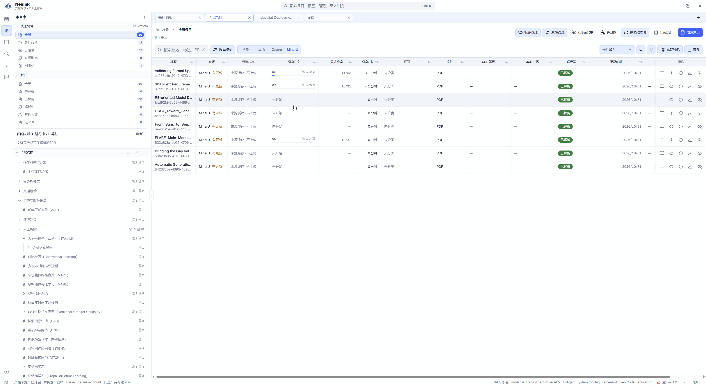
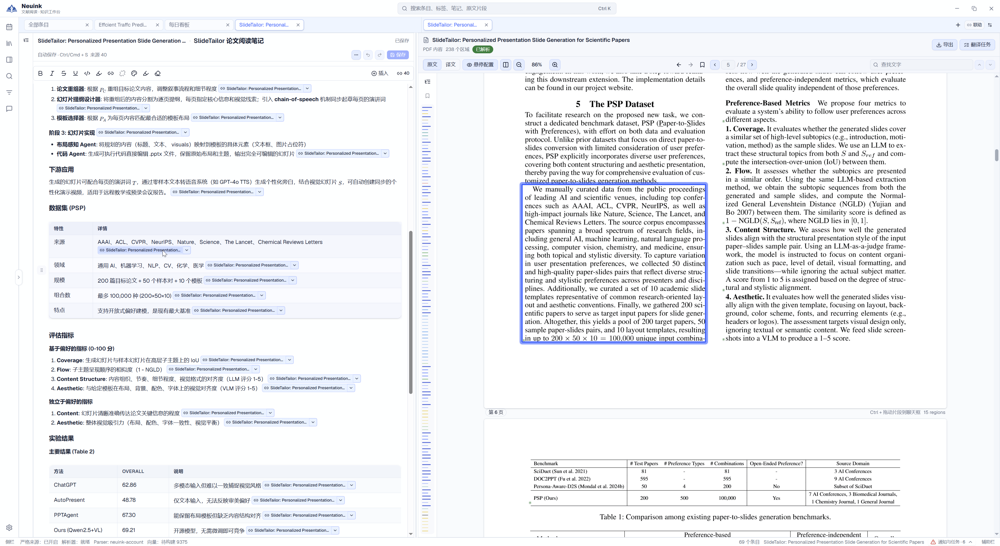
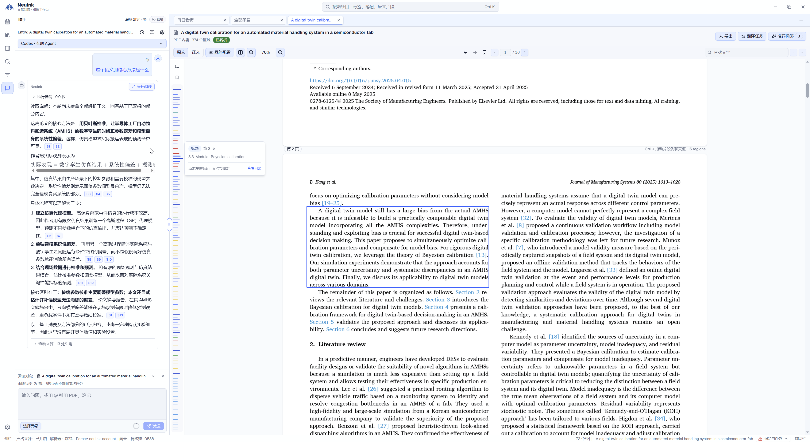

  

<h1 align="center">Neuink</h1>

<strong>让每一次阅读，都留下可追溯的理解。</strong>

翻译、阅读、笔记与 AI，放在同一个本地工作台。

  <a href="https://sugrsertraline.github.io/neuink/">官网与使用手册</a> ·
  <a href="https://cdn.sugrsertraline.top/neuink/releases/current/Neuink-windows-x64-portable.zip">下载 Windows 便携版</a> ·
  <a href="https://github.com/SugrSertraline/neuink/releases/tag/build-20261118.234832">GitHub 发行版本</a> ·
  <a href="README_EN.md">English</a>

  
  
  
  

Neuink 是一款本地优先的文献阅读与知识工作台。从读懂一篇论文开始，把原文、译文、图表和笔记放在一起，再用自己选择的大模型辅助理解与整理。

你可以接入已有的 MinerU 解析结果和 Zotero 资料，也可以直接打开 PDF。基础阅读与笔记无需登录，解析、翻译、模型与云端同步按需配置。

## 翻译：从一个单词，到整篇论文

读到术语时查词，选中句子时翻译，精读时查看段落或全文译文。在 PDF 原始版式与重排视图之间切换，也可以把原文和译文并排放置，随时核对。

- **划词、片段与全文翻译**：按当前需要选择范围，全文任务支持暂停、继续和失败重试。
- **原文、译文与双语对照**：支持左右对照、段落中英对照和逐句阅读，也可专注阅读中文。
- **多种翻译来源**：小牛翻译、DeepL、Azure、Qwen-MT 与自配大模型可以按需选择。
- **不同场景分别设置**：单词、选区、片段、逐句和全文可统一使用同一来源，也可以各自配置。

[了解翻译与双语阅读](https://sugrsertraline.github.io/neuink/translation.html)

## 接入 MinerU 与 Zotero，继续使用已有资料

**MinerU** 将论文解析成段落、公式、表格和图片，为重排阅读、翻译和来源笔记提供结构化内容。Neuink 可以读取完整的解析结果目录，或导入结果 ZIP／RAR；也支持连接兼容的自建 MinerU 服务，以及自部署 Neuink 后端的账号解析队列。

**Zotero** 中已有的论文和笔记可以直接浏览，按需要导入 Neuink。来源缓存与独立本地副本分开管理，只有你明确选择“导入”的条目才成为 Neuink 本地资料。

### 推荐的上手搭配

| 步骤 | 怎么做 |
| --- | --- |
| 1. 准备 MinerU | 下载并使用 MinerU 客户端，把要读的论文导入其中，等待解析完成。 |
| 2. 导入 Neuink | 在 Neuink 读取 MinerU 的完整结果目录，选择论文并导入本地资料库。 |
| 3. 配置小牛翻译 | 在“设置 → 翻译”填写自己的小牛 API Key，验证连接后选择翻译来源。 |
| 4. 按需选择大模型 | 需要论文问答、辅助笔记或 TextFold 时，再配置自己选择的模型。 |

这是我们推荐的组合，解析方式和翻译服务都可以按自己的习惯选择。已有 Zotero 资料也可以从 Zotero 入口开始整理。

[PDF 导入与 MinerU](https://sugrsertraline.github.io/neuink/import.html) · [Zotero 接入](https://sugrsertraline.github.io/neuink/zotero.html) · [第一次使用](https://sugrsertraline.github.io/neuink/start.html)

## 多种阅读方式，把理解留在笔记里

原文阅读保留论文版式；重排阅读将段落、公式与图表连续呈现。用多标签与左右分屏安排工作区，让论文、译文、笔记和助手各在合适的位置。

| 能力 | 适合怎样使用 |
| --- | --- |
| PDF 与重排阅读 | 在原始页面和结构化正文间切换，按目录、页码或片段定位内容。 |
| 分屏与平行阅读 | 一边读论文一边记笔记，或同时对照同一主题下的不同论文。 |
| 悬停预览 | 就近查看图表、文字或来源引用，再决定是否跳转到原文。 |
| TextFold 阅读详略 | 在原文、精简、要点、结论和主题之间切换；生成中英对应结果，也可逐段调整。 |
| 带来源的笔记 | 用文档笔记、标签综合笔记、片段笔记和批注记录理解，保留可返回原文的来源链接。 |
| 阅读成果导出 | 将支持的笔记、解析内容或译稿导出为 Word、TXT 或 Markdown，继续整理与分享。 |

条目库提供**纯表格、纯标签文件夹、标签与表格**三种视图。用层级标签整理研究主题，用可自定义的属性记录年份、期刊、会议或 CCF 等级，并在表格中直接修改属性值。

[阅读与分屏](https://sugrsertraline.github.io/neuink/parallel.html) · [TextFold 阅读详略](https://sugrsertraline.github.io/neuink/reflow.html) · [笔记与来源](https://sugrsertraline.github.io/neuink/sources.html) · [条目与属性](https://sugrsertraline.github.io/neuink/library.html)

## 接入大模型，也能使用本地 Codex

把自己习惯的模型带进阅读工作台。围绕当前论文提问，附加其他材料进行比较，或结合笔记整理思路；回答中的来源入口帮助你回到原文核对。

- **选择自己的模型服务**：支持 OpenAI-compatible、Anthropic 和 Google 接口，可为助手与翻译选择相应模型。
- **接入本地 Agent**：使用本机已安装并登录的 Codex、Claude Code 或 OpenCode，在 Neuink 内继续会话。
- **给助手明确的上下文**：选择论文和笔记，使用 `@` 添加材料，或把原文片段加入对话。
- **审阅后再应用修改**：助手提出笔记或元数据修改时，先查看提案，再决定是否应用。
- **继续寻找资料**：使用本地关键词、语义或混合检索，也可以在线搜索论文与网页，核对后导入。

模型与服务由你选择、配置；本地 Agent 也可能连接远程模型。Neuink 保留原文和来源，方便你检查生成内容。

[模型与助手使用指南](https://sugrsertraline.github.io/neuink/assistant.html)

## 本地优先，云端同步由你决定

论文、笔记和阅读成果默认保存在本机。Windows 便携版使用程序旁的 `data` 文件夹，不登录也可以完成本地阅读、整理和记录。

云端同步是可选功能。我们提供配套后端源码，你可以自行部署、连接并开启同步，也可以一直保持纯本地使用。启用后可查看条目的云端状态和待处理任务，下载、解析、翻译等任务集中在右下角。

备份时先退出 Neuink，再复制整个 `data`；更新程序时保留自己的数据目录。远程解析、翻译与模型服务只在相应功能使用时处理提交给它们的内容。

[数据与备份](https://sugrsertraline.github.io/neuink/data.html) · [可选云端同步](https://sugrsertraline.github.io/neuink/sync.html) · [后端源码与部署说明](deploy/server)

## 下载与开始使用

当前支持 **Windows 10 / Windows 11 x64**。

**[下载 Windows 便携版](https://cdn.sugrsertraline.top/neuink/releases/current/Neuink-windows-x64-portable.zip)** · [下载校验文件](https://cdn.sugrsertraline.top/neuink/releases/current/SHA256SUMS.txt) · [GitHub 发行版本](https://github.com/SugrSertraline/neuink/releases/tag/build-20261118.234832)

当前便携包约 593 MB，版本为 `0.1.4-beta.3`，构建标识 `20261118.234832`（2026 年 11 月 19 日打包）。CDN 与上方 GitHub 发行入口提供同一构建；GitHub 使用独立构建标签，保留历史发行版本。

1. 完整解压到可写文件夹，双击 `Neuink.exe`。
2. 按上方推荐搭配导入已解析的论文，或直接导入 PDF／接入 Zotero。
3. 配置需要的翻译服务，开始阅读；模型与同步可以之后再设置。

便携版无需安装 Node.js 或 Rust；Windows 需要 WebView2 Runtime。更新前退出程序并备份 `data`，替换程序时保留原有数据。

## 交流与反馈

欢迎在 [GitHub Issues](https://github.com/SugrSertraline/neuink/issues) 反馈问题与建议，也欢迎来 [LINUX DO](https://linux.do) 交流。

Neuink 使用 [Apache-2.0](LICENSE) 开源协议。更多功能、操作示例与截图见[官网使用手册](https://sugrsertraline.github.io/neuink/)。

[作者主页](https://sugrsertraline.top/) · [开发指南](docs/development/engineering-guidelines.md)
