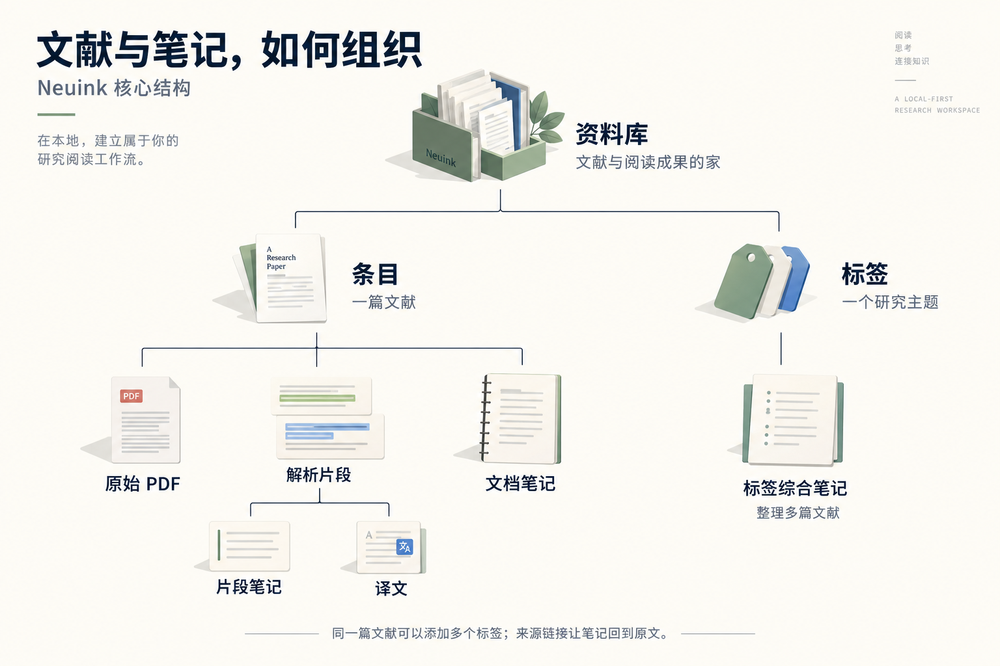
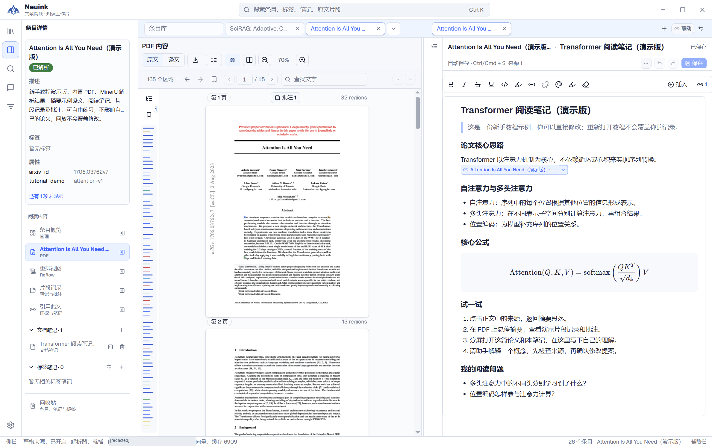

<p align="center">
  
</p>

<h1 align="center">Neuink</h1>

## 当前分支：alpha · 研究卡片与构思探索

`alpha` 是 Neuink 的**公开探索分支**，承接原 `demo/ideation-evaluation` 中的卡片与研究构思功能，用于验证新的阅读、整理证据和构思交互。功能、界面与数据结构仍在迭代，不作为正式发行来源。

| 分支 | 定位 |
| --- | --- |
| [main](https://github.com/SugrSertraline/neuink/tree/main) | 已批准的正式发布分支；官网和下载包从这里发布。 |
| [beta](https://github.com/SugrSertraline/neuink/tree/beta) | 日常开发与集成验证。 |
| [alpha](https://github.com/SugrSertraline/neuink/tree/alpha) | 卡片与研究构思等探索性功能；评审后再逐项进入 beta。 |

本分支保留的探索内容：

- **论文卡片**：整理或生成研究背景、研究问题、方法、结果、适用条件与局限等卡片，并提供来源证据入口。
- **构思画布**：管理多份研究构思，拖入卡片，平移、缩放和排列节点，编辑卡片之间的关系。
- **分支探索**：围绕已有节点选择后续卡片、添加自己的研究问题，并保留构思的关系与布局。
- **研究方案**：选择当前画布中的卡片与关系，由助手模型评价兼容性、证据缺口和风险，生成技术路线与最小验证实验；审阅后保存为方案卡。

这里的“分支探索”指画布中的构思路径。`alpha` 不会自动合并到 `beta` 或 `main`，也不保证包含 `beta` 的最新开发内容。上方表格中的正式下载与本探索分支分别维护。

[隔离交互演示](apps/desktop/ideation-showcase.html)使用示例数据和模拟 IPC，不读取真实论文或调用模型；它不代表原生应用与真实模型链路已经完成验收。

内置的研究启发参考资料保留了 [Microsoft ResearchStudio 的来源说明](apps/desktop/src/modules/ideation/patterns/researchstudio/README.md)与 [MIT 许可](apps/desktop/src/modules/ideation/patterns/researchstudio/LICENSE)。这些模式用于启发构思，不是对用户论文的事实认定。

### 卡片、构思与连线的区别

| 对象 | 用途 | 如何核对 |
| --- | --- | --- |
| 论文卡片 | 提取一篇论文的背景、问题、方法、组件、适用条件、约束、结果或局限。 | 有来源时回到对应论文片段核对；没有来源的内容会提示待核对。 |
| 自建卡片 | 记录自己的研究问题、解释或解决方向。 | 由使用者维护，不能自动视为论文中的结论。 |
| 启发模式卡片 | 提供研究构思的参考方法和组合方向。 | 参考模式与用户论文事实分开，保留第三方来源说明。 |
| 构思画布 | 将选中的卡片放进某个研究问题的工作空间，保存布局与视野。 | 可管理多份构思，同一来源材料可用于不同问题。 |
| 连线与分支 | 表达卡片之间的关系、后续路径或待验证的联系。 | 区分用户建立的关系与模型建议；连线本身不证明因果或创新性。 |

### 从论文整理到构思讨论

1. 准备需要研究的论文与可用正文，在研究构思入口新建一份构思，填写研究问题或目标。
2. 在卡片库中按来源、类型或关键词寻找卡片。也可以手工新建卡片，或使用配置的助手模型提取论文卡片。
3. 查看生成草稿、来源片段与关系建议，选择需要保留的内容；没有可靠出处的内容先核对，不把模型输出直接当作事实。
4. 将卡片拖入当前画布，或通过加入操作放入画布；平移、缩放、查看全图，并按需自动排列或手工调整位置。
5. 选择节点，为下一步选择合适的卡片，添加自己的问题并编辑关系。这里的分支是构思路径，与 Git 的 alpha／beta 分支无关。
6. 点击“评价并生成方案”，选择参与组合的卡片（支持全选、清空与单选），填写具体目标，再开始生成；可以停止。
7. 审阅兼容性、风险、证据缺口、技术路线、最小验证与消融实验、成功／停止标准和替代路线。点击“保存为方案卡”才写入画布；结果附带输入卡片、关系和来源核对快照。修改输入后需要重新评价。

这里使用独立的研究方案任务，尚未实现自动将构思附加到助手聊天。

### 哪些操作需要模型

浏览已有卡片、创建构思、手工编辑、拖动、连线、缩放与保存布局不需要生成模型。论文卡片提取和研究方案评价使用系统选择的助手模型，相应论文或构思上下文会发送至该模型服务。生成草稿需要审阅；已有草稿不等同于已经采纳进画布。

本分支不承诺自动判断学术新颖性、自动证明研究结论或自动完成实验。来源证据入口帮助回查，不代替阅读原文。模型草稿、用户构思和启发模式具有不同来源，应分别对待。

### 当前卡片模板与整理边界

每张卡只表达一个内容，类型决定整理模板；旧卡片仍可读取和编辑。新生成的方法／组件卡以可复用机制为主体，论文模型名称与具体应用放入“原文实例”，不再大段复述摘要；抽象不代表可迁移性已经得到验证。旧草稿需手动重新整理才能采用新模板。手工新建卡片时可填入模板，已有正文不会被模板按钮覆盖。

| 类型 | 模板重点 |
| --- | --- |
| 背景／问题 | 场景、已知进展、目标、现有不足与成功标准 |
| 方法／组件 | 抽象方法或机制、核心步骤与接口、适用边界、原文实例、方法归属 |
| 约束／假设 | 适用范围、成立依据与失效条件 |
| 结果 | 数据集、实验设置、对比基线、指标与结论边界 |
| 局限 | 失败场景、限制原因、作者陈述与模型推断的区别 |
| 自建方向 | 拟组合内容、待验证假设与最小验证实验 |

- 解析正文按真实来源标记分批处理，过长片段继续拆分并保留来源；不再只抽取首尾部分。输入排除个人批注，缺少内容时明确写“原文未说明”。复用系统助手模型连接、上下文与生成参数；上下文过小会提示调整。
- 手动整理和后台整理显示批次进度。单批格式等错误不丢弃成功批次；认证或取消会结束任务。完全相同的卡片合并来源，其他相似卡片仍由用户核对。当前最多 100 批、300 张卡片、600 条关系，达到卡片上限时标记为部分结果；草稿文件不超过 10 MB。
- 只有引用本批真实来源的 AI 卡片进入新整理结果。来源标记说明出处，不意味着 AI 解释已经被证实。分批模式可能缺少跨批关系；当前没有跨批自动综合或断点续跑，重新整理会重新调用模型，可能产生费用。旧的部分草稿不会自动变成完整草稿。
- 方案评价每次选择 1–40 张卡片，最多核对 80 个不同来源片段，来源正文每段最多提供 2400 字。已变化或无法读取的来源明确标记，不能当成已验证证据；用户连线和启发模式也不等于论文结论。
- 方案保存前显示预览，携带完整输入快照，超过本地卡片容量时要求缩小选择范围。结果保留 AI 草稿身份；保存失败保留当前内容并支持重试，不重复添加。关闭未保存的方案预览会丢弃该次临时结果。
- 画布中的方案评价不执行联网查新、不自动运行实验，也不输出缺乏依据的“成功概率”。真实模型效果与原生 Tauri 视觉交互仍需单独验收。

### 本地交互演示

在已经切换到 alpha、且妥善保存原工作区修改的源码目录中安装依赖并启动前端：

```powershell
npm ci
npm --workspace apps/desktop run dev:frontend
```

打开终端显示的地址下的 `/ideation-showcase.html`，默认地址为 `http://127.0.0.1:1420/ideation-showcase.html`。演示用合成论文、卡片和模拟 IPC 展示画布与侧栏；不连接真实资料库、不会调用模型，刷新后不应把演示数据当作持久化成果。

真实资料的保存与来源读取需要原生应用。构思状态和卡片草稿通过资料库模块保存，草稿按论文区分；多个构思的布局彼此独立。此前的浏览器与自动化检查不能证明原生 Tauri 操作和真实模型链路已经完成验收。

### 如何进入后续版本

alpha 的探索功能先独立迭代，再经过代码与交互评审后进入 beta，最终由批准的 main 版本发布。这里保留卡片功能，但不会自动拉入 beta 中所有阅读详略、来源管理等更新。报告问题时请同时说明分支、提交号、操作步骤，以及是在隔离演示还是原生应用中出现。

---

<p align="center">
  <strong><a href="https://sugrsertraline.github.io/neuink/">访问 Neuink 官网 · 完整功能介绍 →</a></strong><br>
  通过实机截图、核心概念和分步教程，了解 Neuink 并开始第一次阅读。<br>
  <a href="https://sugrsertraline.github.io/neuink/start.html">开始阅读</a> · <a href="https://sugrsertraline.github.io/neuink/screenshots.html">查看实机界面</a> · <a href="https://cdn.sugrsertraline.top/Neuink-windows-x64-portable.zip">下载 Windows 便携版</a>
</p>

<p align="center">
  <strong>简体中文</strong> · <a href="README_EN.md">English</a>
</p>

<p align="center">
  <a href="https://github.com/SugrSertraline/neuink">GitHub Repository</a>
</p>

<p align="center">
  <strong>让每一次阅读，都留下可追溯的理解。</strong><br>
  本地优先的文献阅读、证据笔记与 AI 研究工作台。
</p>

<p align="center">
  
  
  
  
  <a href="https://linux.do"></a>
</p>

> **Neuink** 面向论文、报告、标准和书籍章节，把资料整理、PDF 与网页阅读、跨篇对照、来源笔记、检索和 AI 研究放进同一个本地工作区。阅读成果可以回到原文证据，也可以导出为独立文件。

**整理资料 → 阅读与对照 → 记录并连接证据 → 检索与研究 → 导出分享**

[产品官网](https://sugrsertraline.github.io/neuink/) · [作者主页](https://sugrsertraline.github.io/homepage/) · [核心功能](#核心功能) · [阅读详略](#阅读详略操作指南) · [来源与副本](#来源资料与本地副本) · [开始使用](#开始使用) · [常见问题](#开发版常见问题) · [开发与构建](#开发与构建) · [项目文档](#项目文档)

## 0.1.3 预览版更新

- **退出更可靠**：关闭时先让助手任务收尾，并结束应用启动的本地子进程；Codex 断线后可重新连接。
- **网页引用更完整**：助手可接受已验证的方括号网页引用标记。

本版只包含稳定分支中已验证的修复，不包含研究记忆试验功能。查看[发行说明](CHANGELOG.md)。

## 0.1.2 预览版更新

- **数据随程序移动**：Windows 默认把论文、笔记、聊天、设置和阅读状态保存在程序旁的 `data`。退出后复制整个程序文件夹，即可随 U 盘携带。
- **自动整理旧资料**：启动时检查程序目录旁和所在磁盘根目录的 `neuink_data`，补入缺少的文件；冲突保留当前数据，校验成功后旧目录进入回收站。
- **查看 Agent 思考内容**：Claude Code、Codex、OpenCode 返回思考文本或摘要时，在对话中显示实时预览，展开可查看已返回全文并随消息保存。

实验中的全局记忆和局域网共享不在本版范围内。查看[发行说明与验证边界](CHANGELOG.md)。

## 0.1.1 阅读体验更新

- **阅读与引用**：改善 PDF 选字边缘与悬停冲突；按住 Ctrl 拖动一个片段到聊天输入框，拖入时显示遮罩。草稿和已发送消息中的引用都可悬停预览、点击回到原文，未发送引用可删除并撤销。
- **准确选择列表项**：参考文献、编号列表与项目列表按单项添加上下文、笔记和批注；整段列表仍可显式选择。
- **继续上次阅读**：恢复资料库中的标签页、分屏和支持的阅读位置；新对话沿用上次选择的模型或本地 Agent。
- **本地 Agent**：可启用已安装的 Claude Code；另提供 Codex、OpenCode 接入。授权可按次确认或记住，之后可在设置中撤销。各客户端的真实验证范围见[发行说明](CHANGELOG.md)。
- **补齐材料与笔记体验**：无 PDF 的条目可在详情页“获取 PDF”；改进 SciVerse PDF 与图片保存、笔记图片缩放和公式显示。翻译可选择小牛翻译、DeepL、Azure、Qwen-MT 或大模型，支持独立保存服务密钥。

查看[本版改动与验证范围](CHANGELOG.md)，或阅读[助手与引用教程](https://sugrsertraline.github.io/neuink/assistant.html)。

## Windows 便携版下载

**[下载 Neuink Windows x64 便携版（ZIP，CDN 直链）](https://cdn.sugrsertraline.top/Neuink-windows-x64-portable.zip)**

完整解压后双击 `Neuink.exe`，保留随包资源目录，不要在压缩包内直接运行。运行成品不需要安装 Node.js 或 Rust，系统需有 WebView2 Runtime。更新前关闭程序并备份整个 `data`；将新程序文件与原 `data` 放在一起，不要用新包的空 `data` 覆盖个人数据。旧版 `neuink_data` 的自动整理范围见[数据说明](https://sugrsertraline.github.io/neuink/data.html)。

## macOS 预览构建

macOS 暂提供 Apple Silicon 和 Intel 预览构建，可从[自动构建页面](https://github.com/SugrSertraline/neuink/actions/workflows/windows-portable.yml)查看成功任务的下载产物。解压后将 `Neuink.app` 移到“应用程序”。

预览版尚未完成 Apple 公证与 Mac 实机验收，系统可能阻止运行；内嵌网页及视频字幕读取尚未移植。下载与平台说明见[打包与发行](docs/deployment/packaging-and-distribution.md)。

## 完整功能介绍与使用手册

README 提供概览，详细用法收录于 [22 篇专题手册](website/README.md)。现已发布到 GitHub Pages，可通过 **[Neuink 产品与使用指南](https://sugrsertraline.github.io/neuink/)** 阅读，含功能导航、章节全文搜索、手机目录和完整研究流程。

| 想了解什么 | 对应说明 |
| --- | --- |
| 先看实际界面 | [实机界面图解](website/content/screenshots.md)：阅读、翻译、分屏笔记和助手 |
| 安装、资料库、侧栏与分屏 | [第一次使用](website/content/start.md) · [认识工作台](website/content/workspace.md) |
| 条目、标签、属性与解析 | [资料整理](website/content/library.md) · [MinerU 导入](website/content/import.md) |
| PDF、书页模式、重排、翻译与多篇对照 | [PDF](website/content/pdf.md) · [重排](website/content/reflow.md) · [翻译](website/content/translation.md) · [标签阅读](website/content/parallel.md) |
| 笔记、批注、收藏、来源与关系图 | [记录方式](website/content/notes.md) · [来源追溯](website/content/sources.md) · [关系图](website/content/graph.md) |
| 本地搜索、AI、在线文献和网页 | [搜索](website/content/search.md) · [助手](website/content/assistant.md) · [在线研究](website/content/research.md) · [网页与字幕](website/content/browser.md) |
| 分享、设置、迁移与问题排查 | [导出](website/content/export.md) · [设置](website/content/settings.md) · [数据](website/content/data.md) · [研究流程](website/content/workflows.md) · [常见问题](website/content/faq.md) |

## 核心概念



[查看概念关系与实例](https://sugrsertraline.github.io/neuink/concepts.html) · [按流程开始使用](https://sugrsertraline.github.io/neuink/start.html)

| 概念 | 它是什么 | 什么时候用 |
| --- | --- | --- |
| 资料库（Workspace） | 保存在本地的一组文献与阅读成果。 | 按长期研究方向管理自己的资料。 |
| 条目（Entry） | 一篇文献的管理单位，包含标题、PDF、解析结果及相关笔记。 | 导入论文、补充属性、管理文件。 |
| 标签（Tag） | 可有父子层级的主题分类，一篇文献可属于多个标签。 | 汇集同一主题的论文，进行跨篇阅读。 |
| 片段（Segment） | 解析得到的段落、表格、公式或图片等内容单元。 | 定位证据、翻译某段、记录局部想法。 |
| 笔记（Note） | 文档笔记整理单篇论文，标签综合笔记整理跨篇主题。 | 把阅读转化成自己的理解。 |
| 来源链接（Source Link） | 将笔记连接到文献、页码、片段及引用快照。 | 检查某个结论的依据，返回原文核对。 |

## 核心功能

### 1. 资料库：按研究主题组织文献

- 创建条目、导入或批量拖入 PDF，维护标题、描述、层级标签和自定义属性；使用列表或书架浏览资料。
- 从 MinerU 客户端导入解析结果 ZIP，或连接自建 MinerU 兼容服务；解析队列展示等待、进行中和失败状态，并支持重试。
- 按标签及其后代组织阅读范围，查看阅读进度、页码和笔记；条目、笔记及标签的删除与恢复使用相应回收站入口。
- 在关系图中查看标签层级、论文归属、笔记归属和来源引用，搜索、筛选并打开关联内容。图中的关系来自已有数据，不代表自动发现的学术引用网络。

### 2. 阅读工作台：原文、重排与多篇对照

- **PDF 原文**：保留原始版式，支持目录、缩放、片段定位、悬停预览、批注和片段笔记。未解析的 PDF 也可直接阅读。
- **Reflow 重排**：阅读解析后的段落、列表、公式、表格和图片，在原图与解析内容之间按需切换。
- **翻译与对照**：配置翻译服务或模型后，可翻译选区、片段或全文，查看原文与译文；全文任务支持暂停、继续、取消和失败重试。
- **标签平行阅读**：从同一主题的论文列表打开当前论文与右侧对照；两侧独立阅读，配合文档笔记或标签综合笔记整理多篇材料。
- **多标签与分屏**：PDF、重排、笔记、助手完整回复和网页可在工作区中切换；支持标签排序、固定和左右分屏。实时任务面板集中显示解析、翻译、论文添加和助手任务。

### 3. 证据笔记：让结论能回到出处

- 使用 Markdown 编辑器编写文档笔记和标签综合笔记，支持目录、表格、图片、代码、数学公式及 Mermaid 图表。
- 将阅读中的想法保存为片段笔记或批注，使用 Source Link 连接条目、页码、片段和文本快照。
- 在笔记中预览来源、跳回原文、查看反向引用；文档笔记的 Markdown 导出保留可读来源脚注。
- 保存、关闭、跨分屏移动与切换资料库均接入未保存内容保护；已有内容变化时检查冲突。
- 退出时自动定位有修改的页面，并列出待处理项目，可选择“去处理”“保存并退出”或“保留草稿并退出”。文档笔记（含标签／日记笔记）、片段笔记、批注、条目信息、创建条目表单、标签描述、待办、看板和平行阅读的未保存修改，以及模型连接、翻译服务、解析、检索等设置，均接入本地恢复；普通内容保存到当前资料库的 `.neuink-recovery`，记录目标、内容和时间，与正式内容分开。编辑使用 250ms 有界备份队列，保留草稿退出前再次采集当前内容并等待写入成功；保存中的任务需先完成。
- 密钥草稿与普通内容分开，使用本机系统凭据库保存，普通恢复文件只有引用，不包含明文密钥，预览也不显示密钥；只有点击“恢复到编辑器”才读取。安全存储不可用、草稿过大或写入失败时保留修改并阻止“保留草稿并退出”，不退回明文保存。密钥恢复依赖原电脑、原系统账户及原资料库位置，不能仅复制草稿文件到另一台电脑恢复凭据。
- 下次打开通过标题栏“本地草稿”查看时间、复制普通内容并打开对应页面，明确恢复到编辑器后再保存。恢复后的自动保存设置需点击“应用恢复设置”，模型与翻译服务仍需检查后保存，恢复本身不测试连接或启用服务。模型弹窗关闭有未保存保护，明确取消会放弃本次编辑。正式文档及已更新的条目／标签内容不会被静默覆盖。强制结束进程或断电只能恢复最近一次成功落盘的内容，不能保证最后一个按键；运行中的网络请求、导入操作和助手待发送队列不是可恢复的编辑事务。明确放弃修改或成功保存后清理对应草稿及安全凭据。

### 4. 检索与 AI 研究：从资料中找答案，继续寻找文献

- **本地搜索**：关键词搜索覆盖条目、标签、字段、文档笔记、片段笔记、PDF 页面和解析片段；配置本地 embedding 资源后可使用语义与混合搜索。模型缺失或不可用时明确提示降级。
- **带上下文的助手**：关联当前阅读对象，用 `@` 附加 PDF 或文档笔记，通过“选择元素”附加条目和标签，或 Ctrl 拖入片段；也可取消内容关联。对话保留来源、工具过程和提案状态。
- **可审查的修改**：助手修改文档笔记、标签或元数据时先提出 Proposal，展示修改预览，经你确认后应用。标签综合笔记的通用 Agent 写入仍未接通。
- **在线研究**：内置论文搜索、网页搜索和正文读取；按配置使用 arXiv、Crossref、OpenAlex，以及可选 Tavily、Sciverse。候选论文由用户确认后添加，明确区分 PDF 入库和仅元数据结果。
- **模型配置**：支持 OpenAI-compatible、Anthropic 和 Google 协议，可为助手与翻译分别指定模型。

### 5. 网页阅读：把外部材料带入当前研究

Windows 原生应用支持内嵌网页标签、地址栏、前进后退、独立缩放和分屏，最多同时打开 8 个网页。将网页关联为当前阅读对象后，可以让助手按需读取正文或选区，整理为待确认的文档笔记。

| 内容 | 当前读取范围 |
| :--- | :--- |
| 普通网页 | 提取已加载页面的正文；非文章页面回退到有界可见文字。 |
| 公开 PDF | 提取文字，默认前 8 页，可指定每次 1–20 页；显示实际覆盖范围，不自动 OCR 或导入资料库。 |
| YouTube／哔哩哔哩具体视频 | 读取公开简介和可用中英文字幕；无字幕或受限时明确说明，不代表已分析画面和声音。 |

打开网页不会自动把正文发送给模型。公开 PDF／视频读取可能重新请求资源，不携带浏览器 cookies。内嵌网页和视频运行时存在平台限制，详见下方说明。

### 6. 导出分享：把阅读成果带出工作区

| 导出对象 | 已支持格式与范围 |
| :--- | :--- |
| 解析全文、中文译稿、双语稿 | DOCX、TXT、含图片的 Markdown ZIP；支持内容检查及缺失项预览。 |
| 当前论文的文档笔记、片段笔记、批注、译文片段 | 选择项目后合并为 DOCX／TXT，或逐项打包为 DOCX／TXT ZIP。 |
| 文档笔记 Markdown | 另存为本地 MD，保留可读来源脚注。 |

导出读取已保存的完整数据，不受阅读界面折叠或虚拟滚动范围影响。未译、失效译文或缺图会列出，允许确认后导出带说明的草稿。Word 输出保留内容结构，不承诺复刻 PDF 原始排版；中文 PDF、带批注 PDF 和 PPTX 仍不是当前导出能力。

## 阅读详略操作指南

阅读详略用于在重排正文中先快速浏览，再逐段展开核对。它不修改 PDF 文件或作者原文，也不要求把整篇论文一次性发送给模型。当前实现作用于 **Reflow 重排视图的正文段落**；PDF 原版面继续保持原样，标题、公式、表格、图片等不直接压缩。

### 五种详略分别表示什么

| 层级 | 内容来源 | 适合的阅读方式 |
| --- | --- | --- |
| 原文 | 完整的解析原文，不调用模型生成替代文本 | 精读、核对表述、检查方法与证据。 |
| 精简 | 根据已校验的证据句编号提取作者原句，并保持原句顺序 | 减少阅读量，同时尽量保留作者措辞。 |
| 要点 | 模型生成的结论与简短原因 | 快速理解这一段的主要内容与依据。 |
| 结论 | 模型生成的简短核心陈述 | 扫读段落结论，决定是否展开。 |
| 主题 | 从结论中校验、截取的简短主题词组 | 快速浏览文章涉及的话题。 |

默认层级为“原文”，不另设“关闭详略”。“原文”在这里表示**内容完整程度**，与下面的“源语言是否显示”是两项独立设置。模型结果可能遗漏细节；需要引用具体结论时，应切回原文核对。

### 手动生成与任务管理

1. 导入 PDF，并准备好对应的解析结果，然后打开该条目的重排视图。
2. 在系统模型设置中指定助手模型。详略生成复用该模型的连接、采样、最大输出与上下文配置。
3. 点击顶部“生成详略”，先打开任务窗口。打开窗口本身不会立即开始生成。
4. 按需选择单个或多个段落，也可以全选当前列表、选择尚未生成的内容。结合状态、页码和正文搜索缩小范围。
5. 确认选择后开始生成，查看准备、生成、保存等阶段，以及已完成、失败、取消和复用缓存的段落数量。
6. 对失败或取消的条目单独处理；无需为了某一段重新生成整篇论文。悬停、聚焦或点击小眼睛，可查看完整原文、匹配的已保存结果和失败原因。

| 操作 | 实际行为 |
| --- | --- |
| 暂停 | 停止派发新的段落；已发出的请求和保存可以收尾，本次队列保留。 |
| 继续 | 从尚未处理的任务继续派发。 |
| 停止 | 中止本次执行；已经保存的结果仍可阅读。 |
| 单项或批量取消 | 取消所选条目的本次处理，不删除此前保存的有效结果。 |
| 重试 | 重新处理选择的条目，保留其他段落已完成的结果。 |
| 关闭任务窗口 | 只关闭窗口，不停止后台任务；之后可通过进度入口重新查看。 |
| 筛选后全选 | 选择当前可见列表，保留筛选范围之外已经选中的项目，并显示相应数量。 |

队列采用**最多 3 路并发请求**，每个请求负责一个段落，逐段校验并保存。某段输出不完整或不符合格式时可单独失败；服务配置、网络或保存等公共故障会停止继续派发，并显示原因。任务进度按实际处理与保存结果更新，不是固定时间模拟的进度条。

### 哪些段落会生成，怎样控制调用量

- 新任务的最低长度是 **20 个词或 40 个中文字符**。中英混排按一个词折合两个字符计算，空格与标点不计入长度。
- 只处理可独立定位的正文段落；标题、非正文内容、跨页续接组、含行内公式或复杂富内容的段落，以及空内容、重复标识和超过当前长度上限的段落会跳过。
- 当前单段输入上限为 7,500 个字符。任务窗口中的可处理范围以实际解析结果与筛选规则为准。
- 原文未变化且已有有效结果时优先使用缓存；原文变化后，旧结果不再用于该段正文。
- **切换已有详略级别不调用大模型**。调用发生在生成或重试详略、按需生成对应译文等操作中。
- 阅读设置中的“打开重排版时自动生成阅读详略”默认关闭。主动开启后，只处理尚未生成或原文已变化的适用段落；关闭后不再自动启动新的生成任务。

生成携带经过长度限制的文章标题、摘要和章节背景，以帮助模型理解段落。上下文长度表示模型可容纳的请求容量，**不是最大输出 Token 数**。系统会估算输入并预留输出空间；未填写最大输出时遵循共享模型适配器的默认规则，不再另设详略专用的 8,192 Token 输出上限。实际额度仍受模型服务约束。

### 全局切换与单段切换

| 入口 | 影响范围 | 交互表现 |
| --- | --- | --- |
| 顶部阅读详略选择器 | 全局阅读级别，沿用已有单段覆盖规则 | 原文与中文译文直接更新，不播放整篇切换动画。 |
| 段落顶部的详略按钮 | 当前段落 | 使用展开／收缩和文字过渡，其他段落不随之切换。 |
| 鼠标位于段落正文，按住 Ctrl 滚轮 | 当前有有效结果的段落 | 上滚更详细，下滚更简略，到达边界后不循环。 |
| 段落聚焦后 Ctrl + ↑／↓ | 当前段落 | 提供与滚轮相同的键盘操作。 |

没有有效生成结果时，段落仍显示原文，粒度标签使用中性色，悬停提示如何生成；选择一个较短层级不意味着系统已经生成了该结果。普通滚动、选字和 Ctrl 拖入助手引用沿用原交互。段落工具保留固定位置，避免出现额外标签导致滚轮操作时按钮移位。

重排页眉保持“标题与导航／外观操作 + 阅读工具”的两行结构。长标题截断后可悬停查看全文；工具按实际剩余宽度逐项显示，空间不足时收入菜单，宽度恢复后重新显示。

### 全局翻译服务与 API Key

在 **设置 → 翻译** 中，所有翻译场景均可使用专用服务，无需为了全文翻译另外配置大模型。

1. 页面上方是“翻译模型与服务”：小牛、DeepL、Azure、Qwen-MT 各占一条折叠行，点击名称展开配置表单，可同时配置多个来源。行尾显示配置、未保存或处理状态；收起不会丢失输入。填写自己的 API Key；默认地址已预填，DeepL 按账户选择 Free / Pro，Azure 按资源填写区域，Qwen-MT 核对模型与地域。列表最后是独立的“大模型连接”折叠项，展开查看已有连接或进入“配置大模型连接”；下方提示到“翻译行为”选择使用。连接和 API Key 复用“模型与助手”中的配置。
2. 点击“验证并保存”。系统只发送固定英文示例，使用少量服务额度；成功后保存配置，失败保留输入供修改。已有密钥不回显，留空可沿用。
3. 页面下方是“翻译行为”：为单词、选区、单片段、段落逐句和整篇批量分别选择来源，或选择“跟随默认来源”。“默认翻译来源”可直接选择小牛、DeepL、Azure、Qwen-MT 或已保存的大模型连接；修改默认值仅影响跟随默认的行为，已有独立来源保持不变。旧设置保留原有选择；自动翻译开关与范围继续放在行为配置之后，需要显式开启。

| 服务 | 必填信息 | 官方说明 |
| --- | --- | --- |
| 小牛翻译 / NiuTrans | API Key | [文本自动识别接口](https://niutrans.com/documents/contents/trans_detection) |
| DeepL API | API Key、与账户匹配的请求地址 | [API 认证](https://developers.deepl.com/docs/getting-started/auth) |
| Microsoft Azure Translator | API Key；区域按资源要求填写 | [认证与区域](https://learn.microsoft.com/azure/ai-services/translator/text-translation/reference/authentication) |
| 通义 Qwen-MT | 百炼 API Key、模型和匹配地域的地址 | [机器翻译文档](https://help.aliyun.com/zh/model-studio/machine-translation) |

四家配置分别保存，切换来源不会覆盖其他服务的密钥；密钥保存在本机系统凭据库，换电脑需要重新填写。当前统一译为简体中文，费用和可用性以服务账户为准。服务报错不会自动换另一家或调用大模型。

专用服务沿用全文任务进度、暂停、继续、取消和失败重试。长文本分块处理，逐片段保存；公式、代码、链接与结构标记保留，表格按文字单元处理，代码围栏中的图示暂保留原样。普通正文以 MinerU segment 为单位整体翻译，换行和句号不会触发逐句请求；超长正文按预算和安全标点边界分块，保留原 segment 身份。已完成子块在本地缓存，失败重试可复用。逐句对照只对已保存译文做本地切分／对齐，无法可靠配对时显示句组或整段，不另行生成逐句译文。专用服务提交正文前保护公式及格式标记，服务改动标记时拒绝保存。无需向大模型请求论文背景或术语表；已有译文可复用，更换来源不自动重译。

暂停任务继续使用原服务配置；更改其地址、模型或区域后，需恢复配置或取消原任务后新建。旧选区配置与已有密钥自动沿用。阅读详略的中文译文也使用段落来源，**生成详略本身仍需助手模型**。

### 中文翻译与逐句模式

重排阅读有三组独立含义的控制：

| 控制 | 决定什么 |
| --- | --- |
| 阅读详略 | 原文、精简、要点、结论或主题。 |
| 源语言 | 以整段或逐句显示源语言，或隐藏源语言。 |
| 中文译文 | 是否显示对应的中文翻译。 |

详略文本支持对应的中文翻译，使用系统的**段落翻译路由**，并按原段落、详略级别和对应文本保存结果。详略生成与翻译是不同任务；已有普通全文译文不等于每种压缩文本都已经翻译。

**逐句对照与段落详略互斥**：逐句模式需要稳定的句子对应关系，段落压缩会改变这一关系。进入逐句模式时暂时停用段落详略；切回整段，或选择详略级别恢复段落阅读时，已有缓存与单段选择仍保留。这是模式切换，不是永久关闭功能或清除生成结果。

## 来源资料与本地副本

Neuink 区分直接管理的本地条目，以及从 Zotero／MinerU 目录识别出的来源条目。来源接入便于沿用已有资料；需要独立整理与编辑时，再显式导入为本地副本。

### Zotero 与 MinerU 来源

1. 在设置中配置 Zotero 数据目录或 MinerU 本地结果目录，并启用对应来源。
2. 打开资料库时检查可用来源，查看来源论文、读取问题和检查进度。
3. 来源内容变化时，在“来源更新”中逐篇核对标题、字段、文件名等信息；按需采用更新，或确认已经核对。
4. 同一来源版本被确认后不反复提醒；来源再次变化时重新提示。扫描范围受限或读取失败会单独说明。

关闭某个来源开关只隐藏对应的来源条目，不删除来源文件，也不删除已经独立保存的本地副本。此能力是本机资料接入与核对，不等同于 Zotero 云端账号同步或团队云协作。

### 导入独立副本

来源条目提供“导入到本地”“打开本地副本”和“另建一份”等操作。已有对应本地内容时优先打开已有副本；明确选择另建才创建新的独立条目。副本保留来源记录，之后按本地条目管理；普通编辑不会自动改写外部来源。

复制过程中会处理可用 PDF、解析内容与相关阅读成果，并校验引用和来源归属。正在解析的来源需等解析结束后再复制；复制未完成时不把半成品作为成功条目显示。相同内容的 PDF 导入会给出重复提示与核对入口，避免仅因文件名不同产生重复材料。

### Zotero 笔记

- 可选择导入来源条目的 Zotero 笔记，保存独立的 Neuink 笔记并保留来源关联。
- 保存时可查看来源原文、本地内容和差异，选择只保存到 Neuink，或显式确认替换 Zotero 原笔记。
- 本地保存不要求 Zotero 在线；写回路径要求支持本机访问的 Zotero 版本运行并授予权限，当前界面要求 Zotero 10 及以上。
- 写回前重新读取来源版本并备份原文，版本冲突时要求重新核对；本地保存成功但写回失败会分别报告，保留本地草稿。
- 含图片的笔记不支持直接写回；部分导入内容会转换为文本，图片需要回到 Zotero 查看，不能将其视为完整富文本双向同步。

## 条目库与标签管理

条目库支持点击支持排序的表头切换排序，表头居中，标题按可用宽度截断并通过气泡展示全文。行内操作使用平铺图标，悬停显示用途；单选、多选和批量操作共用明确的选择状态。

标签管理提供层级树、展开／收起、画布平移、放大／缩小、复位与右键菜单，便于整理较大的主题结构。标签归属、来源属性和本地编辑权限分别处理；来源条目的受限操作不会伪装成已经成功写入。

## 开发版常见问题

| 现象 | 原因与处理方式 |
| --- | --- |
| 下载包里没有本文的某个功能 | 本文描述 beta；检查该能力是否已经合入 main 并重新发布。alpha 的卡片功能也不会自动出现在 beta 下载或 main 发行中。 |
| PDF 可以看，但没有可用的重排正文 | PDF 原版面不依赖结构化解析。先导入匹配的 MinerU 结果或完成配置服务的解析，再使用重排。 |
| 很多段落没有出现在生成范围内 | 检查是否为正文、是否达到 20 词／40 中文字符，以及是否含公式、复杂内容、跨页续接或超长文本。跳过这些内容是当前适配规则。 |
| 选了“要点”却还是原文 | 该段可能还没有有效缓存。查看粒度提示或任务窗口，而不是反复切换级别。 |
| 提示模型输出达到长度上限 | 检查助手模型的最大输出设置与服务实际限制，再对失败段落重试。增加上下文长度并不等于增加输出额度。 |
| 任务显示暂停但仍有段落完成 | 暂停阻止新派发；此前已经发出的请求或保存仍可收尾。需要结束执行时使用停止。 |
| 开启逐句翻译后不能调段落详略 | 两种阅读方式互斥。切回整段或重新选择详略级别即可恢复，缓存不会因此被删除。 |
| 切换中文详略后缺少译文 | 普通段落译文与详略译文分别保存；先生成当前层级的对应译文，并检查段落翻译路由。 |
| 隐藏来源后本地副本仍然存在 | 本地副本独立维护；关闭来源不是删除文件或回收本地条目。 |
| Zotero 替换失败但本地笔记已保存 | 检查 Zotero 运行、访问授权和版本冲突，刷新差异后再处理；本地保存与来源写回是分别报告的结果。 |

本次开发涉及的界面已包含浏览器演示和自动化回归；**原生 Tauri 视觉验收、真实长文性能和真实模型端到端行为仍需单独验证**。隔离演示不能替代这些验收，测试范围持续记录在开发计划中。

## 界面示例

通过[图文使用指南](https://sugrsertraline.github.io/neuink/screenshots.html)了解系统概念、功能入口和完整操作流程。下图展示 PDF 与来源笔记的分屏工作台。




## 开始使用

### 已有 Windows 便携包

完整解压后双击 `Neuink.exe`，保留随包资源目录。无需安装 Node.js 或 Rust，系统需有 Microsoft Edge WebView2 Runtime。Windows 便携版默认将数据保存在程序旁的 `data`；迁移时先关闭程序，再连同该目录一起复制。更新程序时保留原有数据，具体位置可在资料库与数据设置中核对。

当前项目版本为 **0.1.3**。Windows 提供便携包构建流程；签名、应用内自动更新及原生发行验收仍有待完成。自动构建、下载方式和各平台验收状态见[打包与发行](docs/deployment/packaging-and-distribution.md)。

### 第一次整理一篇论文

1. **创建或打开资料库**：在设置的“资料库与数据”中选择本地 Workspace；新手引导可带你熟悉主要入口，离线演示取决于安装包是否包含演示素材。
2. **导入材料**：直接导入 PDF 即可阅读。需要结构化内容时，在“导入与解析”中查看 MinerU 客户端图文教程：先解析，再导出完整结果并压缩为 ZIP，最后导入 Neuink。
3. **整理与阅读**：添加主题标签，打开 PDF 或 Reflow；需要对照时，从同标签论文列表打开另一篇。
4. **记录证据**：新建文档笔记或标签综合笔记，插入来源链接并保存。
5. **按需启用 AI**：在模型设置中建立连接，为助手和翻译指定模型；选择阅读范围后提问，审阅修改提案。
6. **导出成果**：从 PDF／Reflow 的导出入口生成全文或译稿，从文档笔记或条目概览导出所选阅读成果。

需要解析、重排或翻译时，可按[PDF 导入与解析教程](https://sugrsertraline.github.io/neuink/import.html)操作。普通 PDF 阅读无需先配置解析服务。

## 本地与在线能力

| 能力 | 依赖与数据范围 |
| :--- | :--- |
| 资料管理、PDF／已解析内容阅读、笔记、关键词搜索、已保存成果导出 | 本地完成，不依赖 LLM 或在线解析服务。 |
| 语义／混合搜索 | 需要本地 embedding 资源；不在运行时静默下载模型。 |
| PDF 结构化解析 | 导入已有 MinerU ZIP，或把 PDF 发给自己配置的兼容解析服务。 |
| AI 对话与翻译 | 对话使用自行配置的模型；翻译可使用专用服务或模型，仅向所选来源发送待处理内容。 |
| 阅读详略生成与详略译文 | 分别使用助手模型与段落翻译路由；所选正文及有长度限制的背景发送至对应服务，已有结果切换使用本地缓存。 |
| 在线论文／网页研究 | 需要网络；可选服务还受凭据、权限和配额限制。 |
| 内嵌网页／视频字幕读取 | 原生网页目前在 Windows 启用；视频运行时当前随 Windows x64 包提供。 |

Workspace 是普通本地文件夹，保存 PDF、笔记、批注、标签、译文和会话；搜索等缓存可重建。API Key 不属于 Workspace 或分享包。迁移资料库会复制、验证并保留原目录。

**当前边界**：本地关系图展示已有关系；自动研究方向图、证据对比表、跨原生窗口拖出和团队云协作不在本文已实现能力之列。具体完成度与后续工作统一见[开发计划](docs/development/dev-plan.md)。

## 开发与构建

从源码运行需要 Node.js、npm、Rust stable 和 [Tauri 2 平台依赖](https://v2.tauri.app/start/prerequisites/)。

```powershell
npm install
npm run desktop:dev
```

在已有检出目录中先确认当前分支；不要带着未处理的工作区修改直接切换。只查看前端交互可运行 `npm --workspace apps/desktop run dev:frontend`，但普通浏览器不提供完整 Tauri 文件与原生能力。

| 命令 | 用途 |
| --- | --- |
| `npm --workspace apps/desktop run dev:d-data` | 本机开发入口，默认使用仓库内 `portable/data`；先关闭使用同一份数据的便携程序。 |
| `npm --workspace apps/desktop exec tsc -- --noEmit` | TypeScript 类型检查。 |
| `npm --workspace apps/desktop run test:frontend` | 前端自动化测试。 |
| `cargo test --workspace` | Rust 工作区测试；网络夹具相关场景可按工程规范串行执行。 |
| `npm run desktop:build` | 前端生产构建，不等同于生成已发布桌面安装包。 |

开发演示入口包括 `fold-task-showcase.html`、`fold-gesture-showcase.html` 和 `tag-editor-showcase.html`。阅读详略演示使用合成资料或缓存，适合验证筛选、交互与布局，不读取真实论文或调用模型。卡片演示 `ideation-showcase.html` 属于 alpha 分支。

仓库结构按职责划分：`apps/desktop` 是桌面前端与 Tauri 入口，`crates` 是 Rust 服务和持久化模块，`packages` 放共享代码，`website` 是产品手册与网站，`docs` 保存工程、产品和部署文档。用户资料与构建产物不是需要推送的源码。

基础阅读和笔记不需要配置模型服务。模型资源、网页读取组件和发行打包见[打包与发行](docs/deployment/packaging-and-distribution.md)，开发约定和检查命令见[工程规范](docs/development/engineering-guidelines.md)。

## 项目文档

- [文档索引](docs/README.md)：查找长期维护文档。
- [产品需求](docs/product/01-prd.md)：产品定位与需求边界。
- [系统架构](docs/architecture/system-architecture.md)：当前模块、数据与写盘约束。
- [开发计划](docs/development/dev-plan.md)：已实现内容、待验收项与后续路线。
- [工程规范](docs/development/engineering-guidelines.md) · [UI 设计与交互规范](docs/development/ui-design-system.md) · [系统测试用例](docs/development/system-test-cases.md)。

## 许可证

Neuink 采用 [Apache License 2.0](LICENSE)。第三方组件保留各自的许可证，详见 [第三方组件与许可证](docs/deployment/third-party-components.md) 和 [NOTICE](NOTICE)。

阅读详略移植并调整了 [TextFold](https://github.com/chenxiachan/textfold) 的段落提示词与组装、原文词语对齐和受限过渡算法，固定上游版本为 `5fc941dc4560ee2809c0f278da28457292c7f739`（Copyright 2026 Xia Chen，Apache-2.0）。适配改为使用 Neuink 的模型配置、片段标识、任务队列、持久化与滚动容器；保留上游中英文长度规则，不生成章节摘要。上游 [LICENSE](apps/desktop/public/licenses/TextFold-LICENSE.txt)、[NOTICE](apps/desktop/public/licenses/TextFold-NOTICE.txt) 和修改说明均随项目保留。使用步骤、生成规则与模型边界见[阅读详略操作指南](#阅读详略操作指南)。

翻译容错：PDF 选区请求会先清理视觉换行，英文保留词间空格；小牛等服务的 HTML 上标、公式与代码标记在本地保留。逐项调用失败不会终止后续翻译，已有结果保留，失败项可在任务列表中重试。PDF 悬停原文与译文各自支持整段／逐句，逐句不可用时回退整段并提示。条目库表头按升序 → 降序 → 当前视图默认顺序循环。
