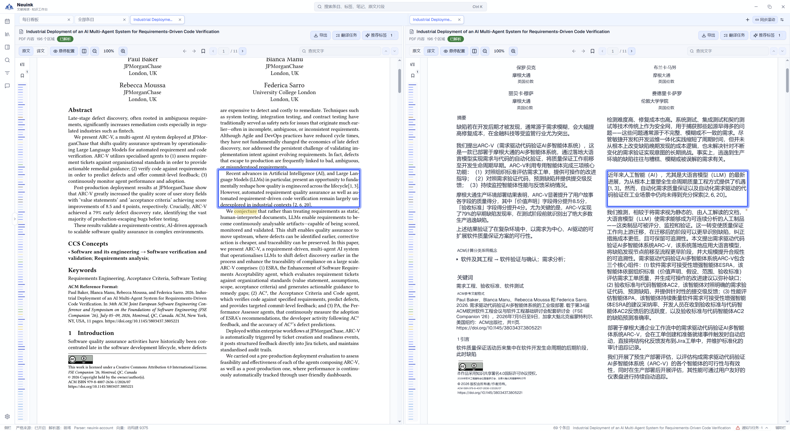
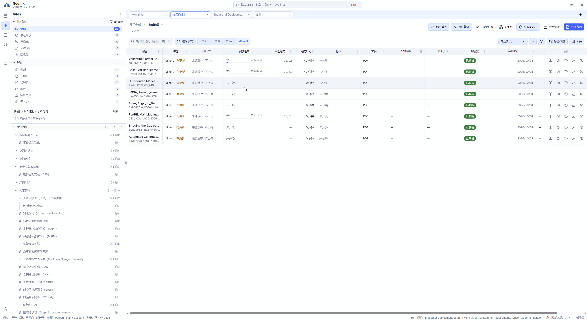
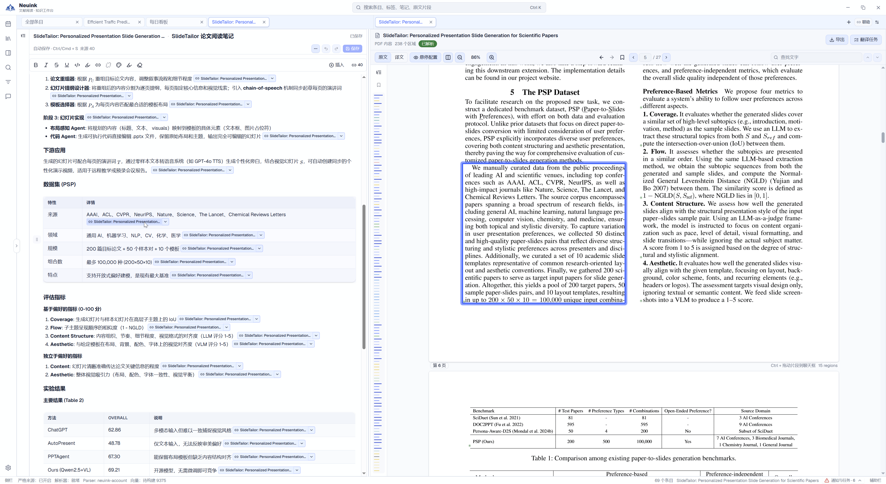
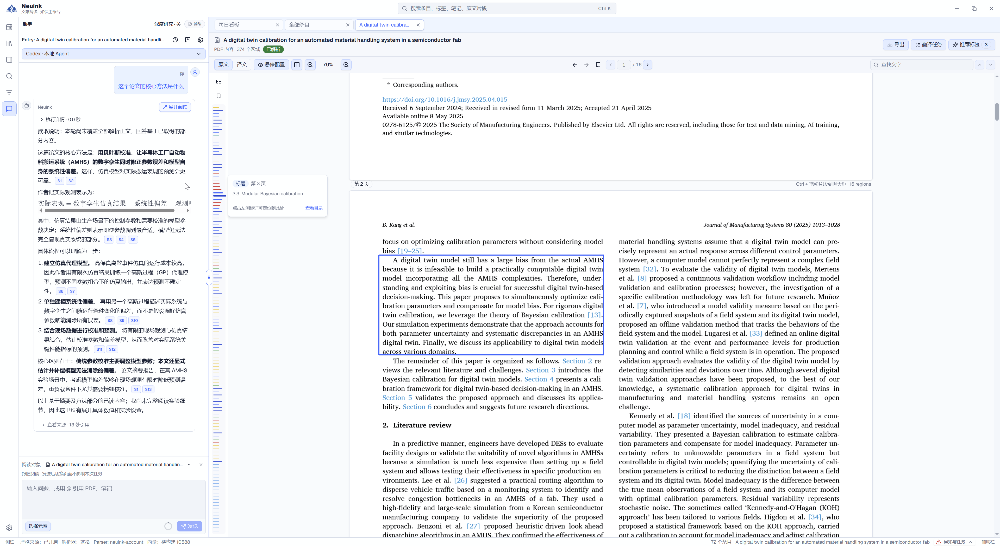

  

<h1 align="center">Neuink</h1>

<strong>Turn reading into understanding you can trace back to its sources.</strong>

Translation, reading, notes, and AI in one local workspace.

  <a href="https://sugrsertraline.github.io/neuink/">Website & handbook</a> ·
  <a href="https://cdn.sugrsertraline.top/neuink/releases/current/Neuink-windows-x64-portable.zip">Download for Windows</a> ·
  <a href="https://github.com/SugrSertraline/neuink/releases/tag/build-20261118.234832">GitHub release</a> ·
  <a href="README.md">简体中文</a>

  
  
  
  

Neuink is a local-first literature reading and knowledge workspace. Bring original papers, translations, figures, and notes together, then use a model of your choice to help understand and organize what you read.

Import existing MinerU results, connect Zotero materials, or open a PDF directly. Basic reading and notes need no account. Configure parsing, translation, models, and cloud sync when you need them.

## Translation: from a word to an entire paper

Look up a term, translate a selected sentence, or read a passage or full-paper translation. Switch between the original PDF layout and reflow, or place the original and translation side by side to check details.

- **Words, selections, passages, and full papers:** Choose the scope you need. Full-paper tasks support pause, resume, and retry.
- **Original, translated, and bilingual views:** Read side by side, compare Chinese and English paragraphs, work sentence by sentence, or focus on the Chinese version.
- **Choose your translation service:** Use Niutrans (小牛翻译), DeepL, Azure, Qwen-MT, or a model you configure.
- **Configure each reading context:** Use one service across words, selections, passages, sentences, and full papers, or choose separately for each.

[Translation and bilingual reading](https://sugrsertraline.github.io/neuink/translation.html)

## Connect MinerU and Zotero to keep using your materials

**MinerU** parses papers into paragraphs, equations, tables, and figures for reflow, translation, and source-linked notes. Neuink can read complete result folders or import ZIP/RAR results. You can also connect a compatible self-hosted MinerU service or use the account-based parsing queue in a Neuink backend you deploy.

**Zotero** papers and notes can be browsed and imported as needed. Source caches and independent local copies are managed separately: an item becomes a Neuink local copy only when you explicitly import it.

### Our recommended starting setup

| Step | What to do |
| --- | --- |
| 1. Prepare MinerU | Download and use the MinerU client. Import the papers you want to read and wait for parsing to finish. |
| 2. Import into Neuink | Read the complete MinerU results folder in Neuink, select papers, and import them into your local library. |
| 3. Configure Niutrans | Enter your own Niutrans API key in Settings → Translation, verify the connection, and select the service. |
| 4. Choose a model if needed | Configure a model of your choice when you want paper Q&A, assistance with notes, or TextFold. |

This is our recommended combination; you can choose other parsing methods and translation services. If you already use Zotero, you can start from its source view instead.

[PDF import and MinerU](https://sugrsertraline.github.io/neuink/import.html) · [Zotero integration](https://sugrsertraline.github.io/neuink/zotero.html) · [Getting started](https://sugrsertraline.github.io/neuink/start.html)

## Read in different ways and keep your understanding in notes

Original PDF reading preserves the paper's layout. Reflow presents paragraphs, equations, and figures continuously. Use tabs and split panes to arrange papers, translations, notes, and your assistant.

| Capability | How to use it |
| --- | --- |
| PDF and reflow | Switch between original pages and structured text; navigate by outline, page, or passage. |
| Split panes and parallel reading | Take notes alongside a paper or compare papers on the same topic. |
| Hover previews | Inspect figures, text, and source references nearby before jumping to the original. |
| TextFold reading detail levels | Switch between the original, a condensed version, key points, conclusions, and topics; generate matching Chinese and English results and refine individual passages. |
| Source-linked notes | Use document notes, topic notes, passage notes, and annotations while retaining links back to the source. |
| Export your work | Export supported notes, parsed content, or translated drafts to Word, TXT, or Markdown for further editing and sharing. |

Browse your library as **a table, tag folders, or both**. Organize topics with hierarchical tags, define properties such as year, journal, conference, or CCF rank, and edit property values directly in the table.

[Reading and split panes](https://sugrsertraline.github.io/neuink/parallel.html) · [TextFold](https://sugrsertraline.github.io/neuink/reflow.html) · [Notes and sources](https://sugrsertraline.github.io/neuink/sources.html) · [Items and properties](https://sugrsertraline.github.io/neuink/library.html)

## Bring your own models or connect local Codex

Bring your preferred model into the reading workspace. Ask about the current paper, add other materials for comparison, or organize ideas alongside your notes. Source references help you return to the original and check the answer.

- **Choose your model service:** Connect OpenAI-compatible, Anthropic, or Google APIs and select models for the assistant and translation.
- **Connect a local agent:** Continue conversations in Neuink with Codex, Claude Code, or OpenCode installed and authenticated on your computer.
- **Provide clear context:** Select papers and notes, add materials with `@`, or attach original passages to the conversation.
- **Review before applying edits:** Inspect proposed changes to notes or metadata and decide whether to apply them.
- **Find more material:** Use local keyword, semantic, or hybrid search, or search papers and web pages online and review them before importing.

You choose and configure models and services. A local agent may still connect to remote models. Neuink retains original materials and sources so you can check generated content.

[Models and assistant guide](https://sugrsertraline.github.io/neuink/assistant.html)

## Local first, with sync as your choice

Papers, notes, and reading results are saved on your computer by default. The Windows portable edition uses the `data` folder beside the program. Read, organize, and take notes without signing in.

Cloud sync is optional. We provide the backend source so you can deploy it yourself, connect, and enable sync—or keep working entirely locally. When enabled, you can see item sync status and pending work. Downloads, parsing, translation, and other tasks are collected in the bottom-right task area.

Close Neuink before backing up the entire `data` folder, and preserve that folder when updating. Remote parsing, translation, and model services process the content you submit when you use those features.

[Data and backup](https://sugrsertraline.github.io/neuink/data.html) · [Optional cloud sync](https://sugrsertraline.github.io/neuink/sync.html) · [Backend source and deployment](deploy/server)

## Download and get started

Neuink supports **Windows 10 / Windows 11 x64 only**.

**[Download the Windows portable ZIP](https://cdn.sugrsertraline.top/neuink/releases/current/Neuink-windows-x64-portable.zip)** · [SHA-256 checksums](https://cdn.sugrsertraline.top/neuink/releases/current/SHA256SUMS.txt) · [GitHub release](https://github.com/SugrSertraline/neuink/releases/tag/build-20261118.234832)

The current portable ZIP is about 593 MB: version `0.1.4-beta.3`, build `20261118.234832`, packaged on November 19, 2026. The CDN and GitHub links above provide the same build. A separate GitHub build tag preserves previous releases.

1. Extract the complete archive into a writable folder and run `Neuink.exe`.
2. Import parsed papers using the recommended setup above, open a PDF directly, or connect Zotero.
3. Configure the translation service you need and start reading. Models and sync can be configured later.

The portable application does not require Node.js or Rust. Windows needs the WebView2 Runtime. Before updating, close Neuink and back up `data`; preserve your existing data when replacing program files.

## Community and feedback

Share issues and suggestions on [GitHub Issues](https://github.com/SugrSertraline/neuink/issues), or join the conversation on [LINUX DO](https://linux.do).

Neuink is open source under [Apache-2.0](LICENSE). See the [website and handbook](https://sugrsertraline.github.io/neuink/) for more features, examples, and screenshots. The handbook and feature overview image are currently in Chinese.

[Author's website](https://sugrsertraline.top/) · [Development guide](docs/development/engineering-guidelines.md)
