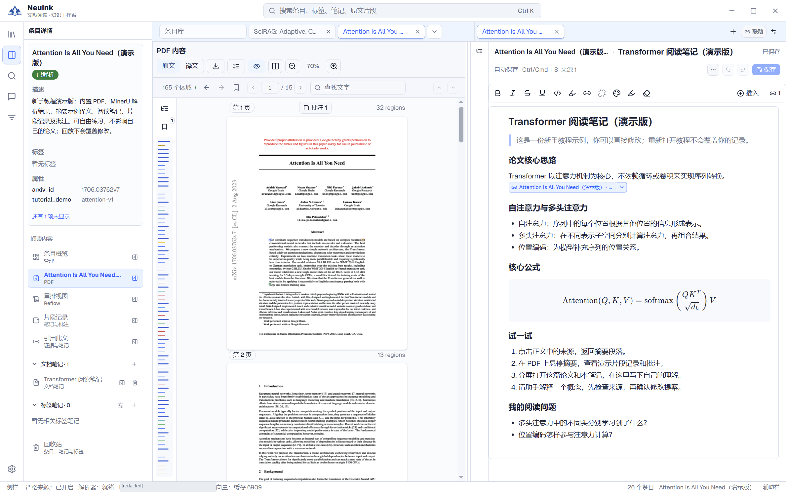

<p align="center">
  
</p>

<h1 align="center">Neuink</h1>

## Current branch: beta — everyday development and integration

`beta` includes the synchronized paper-card workflow. Per-paper cards stay visible; experimental ideation is hidden from navigation and opens only through `/inspiration` in search. Exploration continues on `alpha`; official releases still come from `main`.

| Branch | Purpose |
| --- | --- |
| [main](https://github.com/SugrSertraline/neuink/tree/main) | Approved releases; the public website and download packages are published from here. |
| [beta](https://github.com/SugrSertraline/neuink/tree/beta) | Everyday development and integration validation. |
| [alpha](https://github.com/SugrSertraline/neuink/tree/alpha) | Exploratory features such as research cards and ideation; reviewed changes can move into beta individually. |

The synchronized features include manually generated and reviewed paper cards, a three-section research worksheet (background, questions and method steps), private idea content, model recommendations and report drafts. Reports become local entries only after explicit confirmation. Legacy canvas data remains compatible, but the current workflow does not require manual connections. Native visuals and real-model output quality still need separate acceptance testing.

The [isolated interaction preview](apps/desktop/ideation-showcase.html) uses sample data and mocked IPC. It does not read real papers or call models, and does not establish that the native app or real model integrations have passed acceptance testing.

Bundled research-inspiration references retain the [Microsoft ResearchStudio attribution](apps/desktop/src/modules/ideation/patterns/researchstudio/README.md) and [MIT license](apps/desktop/src/modules/ideation/patterns/researchstudio/LICENSE). These patterns are inspiration, not factual claims about a user's papers.

### Cards, boards and relationships

| Object | Purpose | How to assess it |
| --- | --- | --- |
| Paper card | Capture a paper's background, problem, method, component, assumptions, constraints, results or limitations. | Follow available source evidence back to the paper; unsupported content still needs review. |
| Personal card | Record your own research question, explanation or proposed direction. | Maintained by the user, not automatically a claim made by the paper. |
| Inspiration-pattern card | Suggest methods and combinations for developing ideas. | Keep reference patterns distinct from facts about your materials and retain their attribution. |
| Ideation board | Place selected cards into a research-question workspace and retain its layout and viewport. | Manage multiple ideas independently and reuse materials across questions. |
| Link or branch | Express a relationship, possible next step or connection requiring validation. | Distinguish user-created links from model suggestions; a link alone does not establish causality or novelty. |

### From papers to an idea discussion

1. Generate and review cards under a paper’s Reading Content → Paper Cards page.
2. Enter `/inspiration` in search and select Open Research Ideation or press Enter.
3. Add cards to background, questions and method steps. Dashed placeholders open recommendations and the full library; Describe creates content private to the current idea.
4. Reorder within sections; method order is sent to the model. Recommendations require explicit adoption.
5. Compose an outline or start research. Shared tasks show actual stages and support stopping and retrying.
6. Review the report and explicitly save it to create a local report entry. Generation alone does not create entries or execute experiments.

### What requires a model

Browsing saved cards, creating boards, manual editing, dragging, linking, zooming and saving layouts do not require generation. Paper-card extraction and research-plan evaluation use the selected assistant model, which receives the relevant paper or idea context. Generated drafts require review; having a draft does not mean it has been accepted into the board.

This branch does not promise automatic judgments of academic novelty, proof of research claims or execution of experiments. Evidence links support checking rather than replacing source reading. Model drafts, personal ideas and reference patterns have different origins and should be assessed accordingly.

### Managing paper cards

Open Reading Content → Paper Cards to view independent cards for one paper. Create, search, filter by type, inspect, edit or delete individual cards. Faces emphasize abstractions; details retain paper examples and sources. Deletion confirms the affected canvas-node count before removing that card and its references. Other cards and papers remain, and local canvas overrides are not overwritten by library edits. An empty draft retains its processing record to prevent automatic regeneration after deleting the last card.

### Templates and processing limits

Method/component cards now lead with a reusable abstract mechanism and place paper-specific implementations in a separate example field. Abstraction is not evidence of transferability; existing drafts require explicit regeneration. Card templates distinguish background/problems, method/component interfaces, constraints/assumptions, measured results, limitations and personal hypotheses. Missing paper facts remain explicitly unspecified. Manual template insertion never replaces existing card text; older cards remain editable.

Parsed paper text is processed in source-preserving batches rather than sampled from the beginning and end. Personal annotations are excluded. Manual and background extraction show batch progress and use the configured assistant connection, context and generation settings. Successful batches survive individual format failures; authentication failure or cancellation ends the task. Exact duplicates merge their sources. Limits are 100 batches, 300 cards, 600 relations and a 10 MB draft file. Reaching the card limit marks partial coverage. Cross-batch relationships, automatic semantic deduplication and checkpoint resume are not implemented; rerunning extraction makes new model requests and may incur costs. Old partial drafts are not automatically completed.

Evaluation accepts 1–40 selected cards, checks at most 80 distinct source segments and supplies up to 2400 characters per verified segment. Changed or unavailable sources are labeled accordingly. A real source marker does not prove a generated interpretation. User links and inspiration patterns are hypotheses, not paper evidence.

Results remain temporary until explicitly saved as an AI draft card, with input snapshots. Oversized reports require fewer selected cards. Failed saves preserve the current card and retries do not insert duplicates. Closing an unsaved preview discards that temporary result. No web novelty search, experiment execution or unsupported success probability is provided. Native Tauri visuals and real-provider output quality require separate acceptance testing.

### Local interaction preview

From a checkout containing these changes, after safely preserving previous working-tree edits, install dependencies and start the frontend:

```powershell
npm ci
npm --workspace apps/desktop run dev:frontend
```

Open `/ideation-showcase.html` under the address printed by the development server; the default is `http://127.0.0.1:1420/ideation-showcase.html`. The preview uses synthetic papers, cards and mocked IPC to exercise the canvas and sidebar. It does not connect to a real workspace or call models, and its sample state is not persistent research output.

Real persistence and source access require the native application. The workspace module stores ideation state and per-paper card drafts, while boards retain independent layouts. Prior browser checks and automated tests do not establish completed native Tauri or real-model acceptance testing.

### How exploration reaches a release

Exploratory features evolve on alpha, enter beta after code and interaction review, and reach users through an approved main release. Alpha retains the card feature without automatically importing every beta reading-detail or source-management change. When reporting an issue, include the branch, commit, reproduction steps, and whether it occurred in the isolated preview or native app.

---

<p align="center">
  <strong><a href="https://sugrsertraline.github.io/neuink/">Explore Neuink — Product Website →</a></strong><br>
  Features, real app screenshots, core concepts, and step-by-step tutorials.<br>
  <a href="https://sugrsertraline.github.io/neuink/start.html">Start reading</a> · <a href="https://sugrsertraline.github.io/neuink/screenshots.html">Screenshot guide</a> · <a href="https://cdn.sugrsertraline.top/Neuink-windows-x64-portable.zip">Download for Windows</a>
</p>

## What's new in the 0.1.3 preview

- **Reliable shutdown:** finish active assistant work before closing and stop child processes launched by the app. Codex connections can reconnect after a disconnect.
- **Web citations:** retain verified bracketed web citations in assistant answers.

This update contains verified fixes from the stable branch. The experimental research memory feature is excluded. See the [release notes](CHANGELOG.md).

## What's new in the 0.1.2 preview

- **Carry your data with the app:** on Windows, papers, notes, chats, settings and reading state live in `data` beside the executable. Close Neuink before copying the complete folder to a USB drive.
- **Import legacy data automatically:** startup checks `neuink_data` beside the app and at the drive root, retains current files on conflicts, and moves the old folder to the Recycle Bin only after verification succeeds.
- **Read returned Agent reasoning:** preview thinking text or summaries supplied by Claude Code, Codex or OpenCode, expand the returned content, and revisit it in saved chats.

Experimental global memory and LAN sharing are excluded. See [release notes and validation limits](CHANGELOG.md).

## Reading improvements from 0.1.1

- **Reading and citations:** improved PDF text selection and hover behavior. Hold Ctrl and drag a block into the composer; a translucent overlay marks the drop target. Preview citations on hover and click to return to the source, in drafts and sent messages. Draft references can be removed and restored.
- **Individual list items:** references, numbered lists, and bullet lists now retain item-level context, notes, and annotations, with an explicit whole-list option.
- **Resume reading:** restore workspace tabs, split views, and supported reading positions. New chats remember the last selected model or local Agent.
- **Local Agents:** connect an installed Claude Code client, with Codex and OpenCode adapters also available. Approve operations once or remember permissions, and revoke them in settings. See the [release notes](CHANGELOG.md) for validation limits.
- **Materials and notes:** retrieve a missing PDF from entry details, improved SciVerse PDF/image saving, stable image-resize controls, and formula corrections. Selection translation can use Azure, DeepL, or Qwen-MT independently.

Read the [release changes and validation scope](CHANGELOG.md) or the [assistant guide](https://sugrsertraline.github.io/neuink/assistant.html) (Chinese).

## Downloads and updates

**[Download Windows x64 portable ZIP (CDN)](https://cdn.sugrsertraline.top/Neuink-windows-x64-portable.zip)**

Fully extract the ZIP, keep the bundled resource folders, and run `Neuink.exe`. Do not run it from inside the archive.

Windows requires Windows 10 1903+ / 11 x64 and WebView2. To update, close the app and back up the entire `data` folder. Keep your original `data` beside the new program files; never overwrite it with the empty folder from a public download.

macOS preview builds for Apple Silicon and Intel are available from successful [automated builds](https://github.com/SugrSertraline/neuink/actions/workflows/windows-portable.yml). They are not notarized or validated on a physical Mac; Gatekeeper may block launch. Embedded web pages and the video-caption runtime have not been ported. See [downloads and platform details](docs/deployment/packaging-and-distribution.md).

<p align="center">
  <a href="README.md">简体中文</a> · <strong>English</strong>
</p>

<p align="center">
  <a href="https://github.com/SugrSertraline/neuink">GitHub Repository</a>
</p>

<p align="center">
  <strong>Make every reading insight traceable.</strong><br>
  A local-first workspace for literature, evidence-linked notes, and AI-assisted research.
</p>

<p align="center">
  
  
  
  
  <a href="https://linux.do"></a>
</p>

> **Neuink** brings library management, PDF and web reading, cross-paper comparison, evidence-linked notes, search, and AI research into one local workspace. Return from an insight to its source, or export your work as independent files.

**Organize → Read and compare → Connect notes to evidence → Search and research → Export and share**

[Core features](#core-features) · [Reading detail](#reading-detail-guide) · [Sources and local copies](#source-libraries-and-independent-copies) · [Getting started](#getting-started) · [Troubleshooting](#development-version-troubleshooting) · [Development and builds](#development-and-builds) · [Documentation](#documentation)

## Complete product guide

The [documentation website](website/README.md) contains 22 detailed guides in Chinese, covering workflows, controls, data boundaries, and troubleshooting, with section search and mobile navigation. It is published on GitHub Pages at [Neuink Product & User Guide](https://sugrsertraline.github.io/neuink/). The [guide sources](website/content) can also be read directly in this repository.

## Core features

### 1. A library organized around research topics

- Create entries, import or batch-drop PDFs, and manage titles, descriptions, hierarchical tags, and custom fields. Browse in a table or bookshelf.
- Import MinerU client result ZIPs or connect a self-hosted compatible parser. Track queued, running, and failed parsing jobs and retry failures.
- Browse papers by tag and descendant tags, with reading progress, page positions, and notes. Use the corresponding trash views to recover deleted entries, notes, and tags.
- Explore tag hierarchies, paper membership, note ownership, and source references in the relationship graph. Search, filter, and open related content. These are stored relationships, not an automatically discovered academic citation network.

### 2. A reading workspace for originals, reflow, and comparison

- **Original PDFs:** retain page layout with outlines, zoom, segment navigation, hover previews, annotations, and segment notes. PDFs can be read before parsing.
- **Reflow:** read parsed paragraphs, lists, formulas, tables, and figures, switching between original images and parsed content where available.
- **Translation:** use NiuTrans, DeepL, Azure Translator, Qwen-MT, or a configured model for selections, segments, or full papers. View original and translated text; pause, resume, cancel, or retry full-paper translation tasks.
- **Parallel reading by tag:** open a paper and a comparison paper from the same topic. Read each pane independently and work with document notes or tag-level synthesis notes.
- **Tabs and split views:** arrange PDFs, reflow, notes, complete assistant replies, and web pages using sortable, pinnable tabs and left/right panes. A task panel collects parsing, translation, paper-import, and assistant activity.

### 3. Evidence-linked notes

- Write document notes and tag-level synthesis notes in a Markdown editor with an outline, tables, images, code, math, and Mermaid diagrams.
- Capture segment notes and annotations; Source Links retain the entry, page, segment, and text snapshot.
- Preview sources, jump back to the original, and inspect backlinks. Document-note Markdown exports retain readable source footnotes.
- Unsaved-content protection covers closing, moving between panes, and switching workspaces; version checks protect against overwriting changed content.
- Closing the app locates the edited page and lists pending items, with actions to continue editing, save and exit, or keep local drafts and exit. Recovery covers document/tag/daily notes, segment notes, annotations, entry metadata and creation forms, tag descriptions, todos, pending daily/parallel-reading changes, and settings for models, translation, parsing and research. Ordinary content is checkpointed separately under the current library's `.neuink-recovery` directory with targets and timestamps. A bounded 250 ms queue preserves edits; keeping drafts on exit takes a fresh snapshot and waits for successful storage. In-progress writes must finish first.
- Credential drafts use the persistent OS credential vault, separately from ordinary recovery files. Files contain references, not plaintext keys; previews never show keys. Secrets are fetched only after explicit restoration. An unavailable vault, oversized draft or failed write blocks draft-preserving exit without falling back to plaintext. Credential recovery requires the original computer, OS account and library location; copying recovery files alone does not transfer credentials.
- The title bar's local drafts entry opens previews and the corresponding editing pages. Restoration is explicit; recovered autosave settings require “Apply recovered settings”, while models and translation services keep their existing review/save flow. Restoration itself neither tests connections nor enables services. Closing a modified model dialog is guarded; explicit cancellation discards the edit. Revision conflicts are not silently overwritten. A process kill or power loss can recover only the last successful checkpoint, not necessarily the last keystroke. Running network requests, imports and queued assistant requests are not recoverable editing transactions. Successful saves and explicit discards clear the corresponding drafts and protected credentials.

### 4. Local search and AI-assisted research

- **Local search:** keyword search covers entries, tags, fields, document notes, segment notes, PDF pages, and parsed segments. Optional local embeddings enable semantic and hybrid search, with explicit fallback when unavailable.
- **Context-aware conversations:** associate the current reading object, use `@` for PDFs and document notes, select entries or tags, Ctrl-drag individual segments, or disconnect content. Conversations retain sources, tool activity, and proposal states.
- **Reviewable changes:** document-note, tag, and metadata changes are proposed for review before you apply them. General Agent writing to tag-level synthesis notes is not yet connected.
- **Online research:** built-in paper search, web search, and content reading use configured sources including arXiv, Crossref, OpenAlex, and optional Tavily or Sciverse. Adding candidates requires confirmation; results distinguish downloaded PDFs from metadata-only entries.
- **Model choice:** configure OpenAI-compatible, Anthropic, or Google connections and select separate models for the assistant and translation.

### 5. Web reading within your research workspace

On Windows, native web tabs provide an address bar, back/forward navigation, independent zoom, and split views, with up to eight web tabs. Associate a page with the assistant to read its body or selection on demand and propose a document note.

| Content | Current reading scope |
| :--- | :--- |
| Web pages | Extract the loaded article, with bounded visible-text fallback for non-article pages. |
| Public PDFs | Extract text from the first eight pages by default, or a requested range of 1–20 pages per call. Report coverage; no automatic OCR or library import. |
| Individual YouTube / Bilibili videos | Read public descriptions and available Chinese or English captions. Missing captions and restrictions are explicit; this does not analyze video frames or audio. |

Opening a web tab does not automatically send its body to the model. Public PDF and video reads may fetch the resource again without browser cookies. Platform limits are listed below.

### 6. Export and share reading results

| Content | Supported output |
| :--- | :--- |
| Parsed full text, Chinese translation, bilingual manuscript | DOCX, TXT, or a Markdown ZIP with images; includes content checks and previews of missing items. |
| A paper's document notes, segment notes, annotations, and translated segments | Select items for a combined DOCX/TXT or a ZIP of individual DOCX/TXT files. |
| Document-note Markdown | Save a local MD file with readable source footnotes. |

Exports use saved data, independent of collapsed sections or virtual scrolling. Missing translations, stale results, and missing images are listed; you can explicitly export a draft with these caveats. Word output preserves content structure rather than reproducing the PDF's layout. Chinese PDFs, annotated PDFs, and PPTX are not current export formats.

## Reading detail guide

Reading detail lets you scan a paper and then expand individual paragraphs to check the evidence. It does not modify the PDF or replace the author's source text, and does not require sending an entire paper in one request. The current implementation operates on **body paragraphs in Reflow**. Original PDF pages retain their layout; headings, equations, tables and figures are not directly compressed.

### What the five levels mean

| Level | Content source | Typical use |
| --- | --- | --- |
| Original | Complete parsed source text, without a generated replacement | Close reading and checking wording, methods and evidence. |
| Brief | Author sentences selected through validated evidence indices, in source order | Reduce reading volume while retaining the author's wording. |
| Key points | A model-generated takeaway and short reason | Understand a paragraph's main point and supporting explanation. |
| Takeaway | A short model-generated central statement | Scan conclusions before choosing what to expand. |
| Topic | A short phrase validated against and extracted from the takeaway | Browse the subjects discussed in the paper. |

Original is the default; there is no separate Off level. Here, “Original” means **uncompressed content**, independently of whether source-language text is visible. Generated results may omit details, so return to the original before citing a specific claim.

### Generate and manage tasks

1. Import a PDF and prepare its matching parsed content, then open Reflow.
2. Select an assistant model in system settings. Detail generation reuses its connection, sampling, maximum-output and context configuration.
3. Click Generate detail to open the task window. Opening the window does not immediately start generation.
4. Select individual or multiple paragraphs, all visible rows, or content without results. Combine status, page and source-text filters to narrow the scope.
5. Start the selected work and inspect preparation, generation and saving, with completed, failed, canceled and cached paragraph counts.
6. Handle failed or canceled items individually. Hover, focus or click the eye icon to inspect the complete source, matching saved levels and failure reason.

| Action | Behavior |
| --- | --- |
| Pause | Stop dispatching new paragraphs; requests and saves already in flight may finish. Retain the current queue. |
| Resume | Continue dispatching remaining work. |
| Stop | End the current execution while retaining saved results. |
| Cancel selected items | Cancel the selected work without deleting previously saved valid results. |
| Retry | Reprocess selected items while retaining other paragraphs' completed results. |
| Close the task window | Close the view, not the background task. Reopen it from the progress control. |
| Select all after filtering | Select visible rows and retain existing selections outside the filter, with their count shown. |

The queue uses **up to three concurrent requests**, with one paragraph per request and independent validation and saving. Truncated or invalid output can fail locally; shared service, configuration, network or storage failures stop further dispatch with an explanation. Progress reflects actual work and saving rather than a simulated timer.

### Eligible paragraphs and model usage

- New generation requires at least **20 words or 40 Chinese characters**. Mixed text counts one word as two character units; whitespace and punctuation do not contribute.
- Only independently addressable body paragraphs are eligible. Headings, non-body content, cross-page continuation groups, inline math or rich content, empty text, duplicate identifiers and oversized paragraphs are skipped.
- The current per-paragraph input limit is 7,500 characters. Available tasks depend on the actual parsed content and eligibility rules.
- Reuse valid cached results when the source is unchanged. A changed source paragraph no longer uses its old result.
- **Changing an existing detail level does not call the model.** Generating or retrying detail and requesting a corresponding translation are separate operations that can call configured services.
- Automatically generating reading detail when Reflow opens is opt-in and disabled by default. When enabled, it processes eligible missing or source-changed results; disabling it prevents new automatic starts.

Generation includes bounded document-title, abstract and section context. Context length is the request's capacity, **not the maximum output-token setting**. The shared adapter estimates input and reserves output space. Leaving maximum output unset follows that adapter's defaults; there is no additional detail-specific 8,192-token cap. The provider still enforces its actual limits.

### Global and paragraph-level controls

| Control | Scope | Behavior |
| --- | --- | --- |
| Reading-detail selector in the top toolbar | Global level, with existing paragraph override rules | Update source text and Chinese translations immediately, without whole-document animations. |
| Detail buttons above a paragraph | That paragraph | Expand or compress text with transitions, leaving other paragraphs unchanged. |
| Hold Ctrl and scroll over paragraph text | The paragraph with a valid result | Scroll up for more detail, down for less; stop at the endpoints without wrapping. |
| Ctrl + Up/Down on a focused paragraph | That paragraph | Keyboard equivalent of the wheel gesture. |

Without a valid result, a paragraph retains its original text and uses neutral detail controls with a generation hint. Selecting a shorter level does not imply that its result already exists. Ordinary scrolling, text selection and Ctrl-dragging references keep their existing behavior. Paragraph controls retain stable positions during changes.

The Reflow header keeps a title/navigation row and a reading-tools row. Truncated titles expose their full text in a tooltip. Controls use measured available space, enter the overflow menu when necessary and return when room becomes available.

### Global translation services and API keys

In **Settings → Translation**, configure sources first in the upper **Translation models and services** section. NiuTrans, DeepL, Azure and Qwen-MT each have an independent collapsed row: expand it to edit, and collapse it without losing the draft. Rows show configuration, unsaved and processing states. Existing model connections remain shared with the model settings page. Enter your API key, then click **Validate and save**. This sends only a fixed English example and uses a small amount of service quota. Failed validation retains the draft. DeepL requires the endpoint for your API account, Azure may require the resource region, and Qwen-MT requires a matching model and region endpoint. The lower **Translation behaviors** section assigns a model or service to each action, or one source to all five; automatic translation controls follow below.

Choose the service in the unified translation-source selector to apply it to words, selections, individual segments, paragraphs/sentence alignment, and full-document batches. Per-scenario selectors remain available. Automatic translation requires its own switch; local dictionary lookup can still take precedence for known words.

The four services retain independent configurations. A separate **Model connections** disclosure follows the service rows: expand it to see existing models or open their configuration page. The hint below explains that connections and API keys are shared with model settings, and models are assigned in **Translation behaviors**. Keys stay in the OS credential vault and are never returned to the form. Current translations target Simplified Chinese. Provider failures do not silently switch services or use a model. See the official [NiuTrans](https://niutrans.com/documents/contents/trans_detection), [DeepL](https://developers.deepl.com/docs/getting-started/auth), [Azure](https://learn.microsoft.com/azure/ai-services/translator/text-translation/reference/authentication), and [Qwen-MT](https://help.aliyun.com/zh/model-studio/machine-translation) documentation for account requirements.

Service-based document translation reuses the task progress, pause/resume/cancel, retry, and per-segment persistence flow. Long text is split within request limits; formulas, code, links, and structural markers stay local. Fenced diagrams remain unchanged. Ordinary prose is translated as a complete MinerU segment. Only oversized segments are split at safe boundaries within request budgets, retaining the original segment identity. Completed chunks are checkpointed locally for retry. Sentence view locally aligns the saved segment translation and falls back to sentence groups or the full paragraph; it does not generate another translation. Protected formula/format tokens must survive service responses exactly or the result is rejected. No model-generated paper background is required. Existing translations and legacy selection-service credentials are preserved.

Paused tasks retain the original service identity. Changing its endpoint/model/region requires restoring that configuration or starting a new task. Chinese reading-detail translations use the paragraph route; **generating reading-detail levels still requires the assistant model**.

### Chinese translation and sentence mode

Three controls have independent meanings:

| Control | What it determines |
| --- | --- |
| Reading detail | Original, Brief, Key points, Takeaway or Topic. |
| Source language | Paragraph display, sentence display or hidden source text. |
| Chinese translation | Whether to show the corresponding Chinese text. |

Detail text supports corresponding Chinese translations through the system's **paragraph-translation route**. Results are associated with the source paragraph, detail level and matching text. Detail generation and translation are separate tasks; an ordinary full-paragraph translation does not mean every compressed variant has already been translated.

**Sentence alignment and paragraph detail are mutually exclusive.** Sentence comparison needs stable sentence pairs, while paragraph compression changes that relationship. Sentence mode temporarily suspends paragraph detail. Returning to paragraph layout or selecting a detail level restores paragraph reading, with cached results and paragraph choices retained. This does not permanently disable the feature or delete generated content.

## Source libraries and independent copies

Neuink distinguishes directly managed local entries from source entries recognized in Zotero or MinerU directories. Source connections reuse existing materials; explicitly import an independent local copy when you want to organize and edit it separately.

### Zotero and MinerU sources

1. Configure a Zotero data directory or MinerU result directory and enable that source.
2. Open the workspace to check available sources, source papers, read issues and progress.
3. When a source changes, review titles, fields and filenames in Source updates. Apply individual changes as appropriate or mark them reviewed.
4. An acknowledged source revision does not repeatedly prompt; a later revision can prompt again. Scan limits and read failures are reported separately.

Disabling a source hides its source entries without deleting external files or independently saved local copies. This is local source discovery and review, not Zotero cloud-account synchronization or team cloud collaboration.

### Import independent copies

Source entries expose Import locally, Open local copy and Create another copy actions. Existing matching local content is reused unless you explicitly request another independent entry. Copies retain provenance and are then maintained locally; ordinary edits do not automatically rewrite the external source.

Copying handles available PDFs, parsed content and related reading results, with reference and provenance checks. Wait for active parsing to finish before copying a source. Incomplete copies are not presented as successfully created entries. PDF import also reports matching content and provides a review path so a filename change alone does not create an unnoticed duplicate.

### Zotero notes

- Select source notes to import as independent Neuink notes with source associations.
- Compare source text, local content and differences when saving; choose local-only saving or explicitly confirm replacement of the original Zotero note.
- Local saving does not require Zotero to be online. The write-back path requires a running Zotero version supporting authorized local access; the current UI specifies Zotero 10 or later.
- Before write-back, reread the source version and back up the original. Conflicts require another review. A successful local save and a failed source write are reported separately, with the local draft retained.
- Notes containing images cannot be written back directly. Some imported content is converted to text and images must be viewed in Zotero. This is not complete rich-text bidirectional synchronization.

## Library and tag management

Click sortable column headers to change ordering. Table headers are centered, titles truncate to available width with full-title tooltips, and row actions are displayed as icons with hover explanations. Single selection, multiple selection and batch actions use explicit selection state.

Tag management provides a hierarchical tree, expand/collapse controls, panning, zoom, reset and context menus for larger topic structures. Tag membership, source properties and local editing permissions remain distinct; restricted source operations are not reported as successful writes.

## Development-version troubleshooting

| Symptom | Explanation and next step |
| --- | --- |
| A downloaded package lacks a feature described here | This README describes beta. Check whether the feature reached main and a new release. Alpha card features do not automatically appear in beta or main. |
| A PDF opens but no Reflow content is available | Original PDF reading does not require parsing. Import matching MinerU output or complete parsing through the configured service. |
| Many paragraphs are unavailable for generation | Check body type, the 20-word/40-character minimum, math or rich content, continuation groups and the input-length limit. These exclusions are intentional. |
| Selecting Key points still shows original text | The paragraph may have no valid cached result. Inspect its hint or task row instead of repeatedly changing levels. |
| Model output reached its length limit | Check the assistant model's maximum output and the provider limit, then retry affected paragraphs. Increasing context capacity does not itself increase the output allowance. |
| Some paragraphs finish after pausing | Pause prevents new dispatch; requests and saves already in flight can finish. Use Stop to end execution. |
| Paragraph detail is unavailable in sentence mode | The modes are mutually exclusive. Return to paragraph display or select a detail level; cached results remain. |
| A Chinese detail level has no translation | Ordinary paragraph translations and detail translations are stored separately. Request that level's translation and check the paragraph-translation route. |
| Local copies remain after hiding a source | Copies are independently managed. Hiding a source is not file deletion or removal of local entries. |
| Zotero replacement failed after a local save | Check the running Zotero instance, authorization and source-version conflicts, then refresh the comparison. Local and external saves have separate outcomes. |

These development workflows include browser previews and automated regression coverage. **Native Tauri visual acceptance, real long-document performance and real-model end-to-end behavior still require separate validation.** Isolated previews do not replace those checks; the development plan records their scope.

## Interface examples

Read the [illustrated user guide](https://sugrsertraline.github.io/neuink/screenshots.html) (Chinese) for core concepts, feature entry points, and step-by-step workflows. The workspace below places the original PDF beside evidence-linked notes.




## Getting started

### If you already have a Windows portable build

Extract the complete archive and open `Neuink.exe`, keeping its resource directories beside it. Node.js and Rust are not needed; Microsoft Edge WebView2 Runtime is required. Windows portable builds default to the `data` directory beside the program. Close the app before moving the complete folder, retain your existing data during updates, and confirm the active location in data settings.

The project version is **0.1.3**. A Windows portable build workflow exists; signing, in-app updates, and native distribution validation still have outstanding work. See [packaging and distribution](docs/deployment/packaging-and-distribution.md) for automated builds, downloads, and platform validation status.

### Your first paper

1. **Create or open a workspace** in the data settings. Onboarding introduces the main controls; offline examples depend on the build including demo assets.
2. **Import a PDF** to read immediately. For structured content, follow the in-app MinerU client guide: parse externally, export the complete results as a ZIP, then import them into Neuink.
3. **Organize and compare:** assign topic tags, open PDF or Reflow, and choose another paper from the same-tag list for comparison.
4. **Capture evidence:** create a document or tag-level note, insert Source Links, and save.
5. **Enable AI as needed:** configure connections and assign assistant/translation models, select your context, ask questions, and review proposed changes.
6. **Export:** use the PDF/Reflow export action for manuscripts, or the document note / entry overview for selected reading results.

For parsing, reflow, or translation, follow the [PDF import and parsing tutorial](https://sugrsertraline.github.io/neuink/import.html) (Chinese). Reading an ordinary PDF does not require a parser service.

## Local and online capabilities

| Capability | Requirements and data scope |
| :--- | :--- |
| Library management, PDF / parsed-content reading, notes, keyword search, saved-result exports | Local; no LLM or online parser required. |
| Semantic / hybrid search | Optional local embedding resources; no silent runtime model downloads. |
| Structured PDF parsing | Import an existing MinerU ZIP or send the PDF to your configured compatible parser. |
| AI conversations and translation | Your configured model service receives the relevant context. |
| Reading-detail generation and detail translations | Use the assistant model and paragraph-translation route respectively; selected text and bounded context go to those services, while switching saved results uses local caches. |
| Online paper / web research | Network access; optional services also depend on credentials, permissions, and quotas. |
| Embedded web pages / video captions | Native embedding currently runs on Windows; the bundled video runtime currently targets Windows x64. |

A Workspace is a normal local folder containing PDFs, notes, annotations, tags, translations, and conversations. Search caches can be rebuilt. API keys are not part of the Workspace or sharing bundles. Workspace migration copies and verifies data while retaining the original directory.

**Scope:** the local graph displays existing relationships. Automated research-direction maps, evidence comparison tables, dragging tabs into separate native windows, and team cloud collaboration are not among the implemented features described here. The [development plan](docs/development/dev-plan.md) tracks completion and remaining work.

## Development and builds

Install Node.js, npm, Rust stable, and the [Tauri 2 prerequisites](https://v2.tauri.app/start/prerequisites/), then run:

```powershell
npm install
npm run desktop:dev
```

Confirm the branch in an existing checkout before making changes; do not switch branches with unresolved working-tree edits. For frontend interactions only, use `npm --workspace apps/desktop run dev:frontend`. A normal browser does not provide the complete Tauri filesystem or native capabilities.

| Command | Purpose |
| --- | --- |
| `npm --workspace apps/desktop run dev:d-data` | Local development with the repository's `portable/data` by default; first close any portable instance using the same data. |
| `npm --workspace apps/desktop exec tsc -- --noEmit` | TypeScript checking. |
| `npm --workspace apps/desktop run test:frontend` | Frontend automated tests. |
| `cargo test --workspace` | Rust workspace tests; run network-fixture scenarios serially as directed by engineering guidelines. |
| `npm run desktop:build` | Frontend production build, not publication of a desktop installer. |

Development previews include `fold-task-showcase.html`, `fold-gesture-showcase.html` and `tag-editor-showcase.html`. The detail previews use synthetic materials or cached results to exercise filtering, gestures and layout without reading real papers or calling models. The card preview, `ideation-showcase.html`, belongs to alpha.

Repository boundaries: `apps/desktop` contains the desktop frontend and Tauri entry point; `crates` contains Rust services and persistence; `packages` contains shared code; `website` contains the product guides and site; `docs` contains engineering, product and deployment documentation. User data and generated build output are not source files to publish.

Basic reading and notes do not require a model service. See [packaging and distribution](docs/deployment/packaging-and-distribution.md) for model resources, browser-reading components, and release builds, and [engineering guidelines](docs/development/engineering-guidelines.md) for development checks.

## Documentation

- [Documentation index](docs/README.md)
- [Product requirements](docs/product/01-prd.md) and [system architecture](docs/architecture/system-architecture.md)
- [Development plan](docs/development/dev-plan.md): implementation status and pending validation
- [Engineering guidelines](docs/development/engineering-guidelines.md), [UI design system](docs/development/ui-design-system.md), and [system test cases](docs/development/system-test-cases.md)

## Licence

Neuink is licensed under [Apache-2.0](LICENSE). Third-party components retain their own licences; see the [component summary](docs/deployment/third-party-components.md) (Chinese) and [NOTICE](NOTICE).

Reading detail adapts the paragraph prompt and assembly, source-word alignment and bounded transitions from [TextFold](https://github.com/chenxiachan/textfold), pinned to revision `5fc941dc4560ee2809c0f278da28457292c7f739` (Copyright 2026 Xia Chen, Apache-2.0). The adaptation uses Neuink model settings, segment identifiers, queues, persistence and scroll containers, retains the upstream English/CJK length rules and omits section summaries. The upstream [LICENSE](apps/desktop/public/licenses/TextFold-LICENSE.txt), [NOTICE](apps/desktop/public/licenses/TextFold-NOTICE.txt) and modification notices are retained. See the [reading-detail guide](#reading-detail-guide) for operations, eligibility and model limits.

Translation settings provide one **Default translation source** selector for dedicated translation services and saved LLM connections. Each behavior can follow this default or keep its own override. Changing the default does not overwrite explicit choices or existing translations; legacy settings preserve their previous sources.

Translation requests normalize PDF selection line wraps locally without changing annotations. Dedicated services keep superscripts, formula and code markers locally; individual request failures remain attached to their segments and do not stop the remaining work. PDF hover settings nest paragraph/sentence choices under source and translation visibility, with explicit paragraph fallback notices. Library headers cycle ascending, descending, then the current view default.

Research cards are generated only on explicit user action. Opening the library never generates cards or retries old failures. AI cards require confirmation before canvas placement or research-plan generation. Review actions open the source paper’s card-management page.

The research dialog accepts optional background, available inputs, and expected outputs, including reviews and analysis reports. Generated reports can be reviewed and edited before explicit confirmation creates a local entry. Closing discards unsaved dialog drafts; generation alone does not create an entry.

The canvas can suggest relationships using the configured assistant model. Proposed links remain transient dashed previews until explicit acceptance, with editable types, reasoning, and conditions. Existing links are preserved. Research on an unconnected multi-card board offers this step but can proceed without it. Wheel zoom is centered on the pointer.

### Alpha: sparse research relationships

Relationship suggestions prioritize the background, core question, main method and validation plan. Evidence, constraints and alternatives are not connected by default; composition details remain in card content and suggestion rationale. No composite cards are created automatically. AI additions count existing links against a budget of at most eight links and one fewer than the non-constraint card count, and avoid cycles. Modifications and deletions require individual confirmation. Manual links retain custom descriptions, bidirectional arrows and no-arrow connections, including feedback loops when needed. This conservative default is not a restriction on research structure.

### Alpha: method-guided research worksheet

The default ideation page now contains background, question, methods, requirements and a composition plan. Users add cards with buttons rather than arranging a canvas. Existing cards and historical links remain stored, but worksheet reports exclude old graph links.

Adding a method requests up to three recommendations from the configured assistant model, restricted to confirmed library methods/components and manual methods. Recommendations distinguish complements from alternatives and explain fit, integration and conditions. Adding recommendations and adopting composition drafts require explicit actions. No historical co-use statistics, vector ranking or verified compatibility is claimed. Requests include at most 120 candidates with 2,000-character excerpts; limited scope and context-budget errors are surfaced.

Worksheet fields and adopted plans use existing autosave; unaccepted suggestions remain session-local. Input changes invalidate pending results, and leaving or stopping cancels requests. Reports still require confirmation before creating a local entry. Automated tests validate state and request behavior; live-model recommendation quality and native visual acceptance remain to be assessed.

All five worksheet sections accept multiple cards, either from the sidebar or as private descriptions belonging to the current idea. Cards normally fit three per row and wrap on narrower pages. Method steps have explicit numbering and move-earlier/later controls. Their persisted order is sent to recommendation and report generation as a proposed sequence, not verified compatibility. Reordering invalidates previous suggestions without triggering another model request.

### Current Alpha: three research-material sections

The worksheet now has Background, Research questions, and Method steps. Constraints, inputs/outputs and existing findings belong to Background; historical composition content remains under the research-thinking draft. Each section has a Describe action for private cards and a white, dashed empty slot that opens matching AI recommendations at the top of the sidebar, with all cards and manual filters below. Placement roles preserve the source card's original type and content.

Drag cards by their handles within a section, or use earlier/later buttons and handle arrow keys. Only a completed drop saves the order; Escape and focus loss cancel. Method numbering and order are supplied to the model, while other ordering indicates display priority. Reordering does not trigger model calls. Recommendations are snapshot-bound, cancellable and limited to confirmed candidates; all library cards remain available when recommendation fails. Native desktop visual/drag acceptance and live-model quality evaluation remain outstanding.

Research card recommendations, composition and report generation now use the shared task list and notifications, with actual stage messages, cancellation and completion/failure feedback. Retrying replaces previous terminal notifications of the same kind. Composition only reads selected cards; reports remain drafts until explicitly saved. All 171 relevant tests and type checking pass. Isolated browser checks cover core interactions and three viewport widths; native Tauri visuals and real-model output quality have not been validated in this pass.


### Experimental entry point

Per-paper AI cards remain available in reading content and are generated only on request. The ideation navigation entry is hidden. Type `/inspiration` in global or sidebar search, then select the result or press Enter to open the workspace. A ready library is required; the command does not run AI. Experimental tabs and the sidebar do not reopen on restart; saved cards and ideas are preserved.
