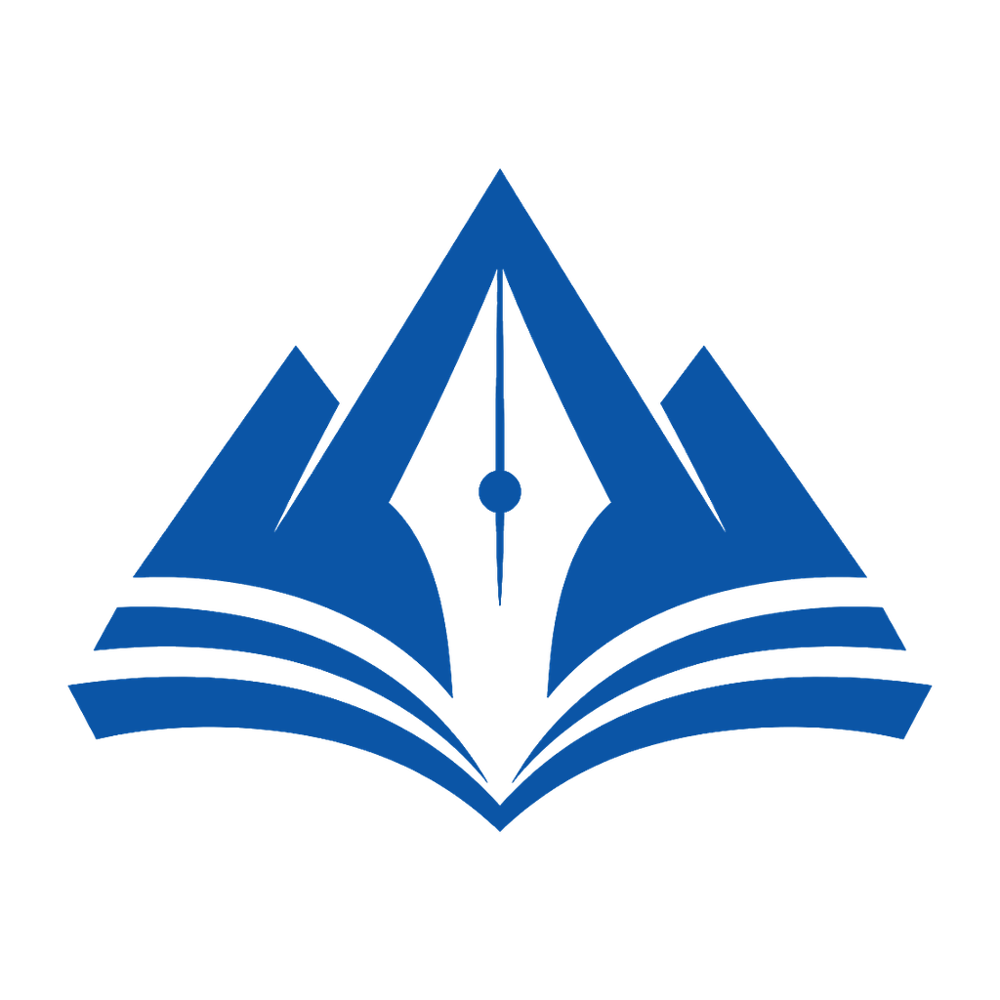

  

<h1 align="center">Neuink</h1>

<strong>Turn reading into understanding you can trace back to its sources.</strong>

A local-first literature reading and knowledge workspace for Windows

  <a href="https://sugrsertraline.github.io/neuink/">Website & handbook</a> ·
  <a href="https://cdn.sugrsertraline.top/Neuink-windows-x64-portable.zip">Download for Windows</a> ·
  <a href="https://github.com/SugrSertraline/neuink/releases">GitHub downloads</a> ·
  <a href="README.md">简体中文</a>

Neuink brings your papers, PDF reading, bilingual text, source-linked notes, and AI assistance into one workspace. Start with a single PDF or connect an existing Zotero library, then build your own body of knowledge as you read.

Your library lives on your computer. Basic reading and notes require no account. Parsing, translation, AI services, and campus-network sync are optional.

## Read, compare, and keep the evidence

- **PDF and reflow:** Keep the original layout or read structured paragraphs, equations, tables, and figures. Tabs and split panes put papers, translations, and notes side by side.
- **Bilingual reading and detail levels:** Switch between the original, a condensed version, key points, conclusions, and topics. Generate corresponding Chinese and English results; translate selections, passages, or an entire paper.
- **Source-linked notes:** Document notes, topic notes, passage records, and annotations serve different purposes. Source snapshots preserve context and link back to the original passage.
- **Continue where you left off:** Reading positions, bookmarks, and recent reading help you resume. Read related papers together with topic-based navigation.

## Organize papers your way

Choose a **table, tag folders, or both**. Browse topics like folders, or compare papers using publication year, venue, and your own properties.

Tags organize topics; properties describe items. One paper can belong to several topics without duplicating its PDF.

| Feature | What you can do |
| --- | --- |
| Library-wide properties | Define text, number, date, single-choice, multiple-choice, and boolean fields. Dates can have year, month, or day precision. |
| Publication fields | Start with publication type, journal/conference, year, DOI, JCR quartile, CCF rank, and other fields, then add your own. |
| Edit in the table | Click a property value to edit it. Selection changes save automatically, with an option to leave the value empty. |
| Configurable columns | Reorder fields in the column dialog, choose visible columns, and resize them. Row actions adapt to the available width. |
| Metadata lookup | Search arXiv and Crossref, review a match, and fill supported empty fields without replacing existing values. Journal and conference rankings remain user-entered. |

Connect local Zotero data to browse source items before importing selected independent copies. Browsing or hiding a source does not delete the original or automatically import the entire library. Notes can be imported and compared, with write-back requiring an explicit choice.

## Add parsing and AI when you need them

Reading a PDF does not require MinerU. For reflow and structured passages, choose an account-based parsing service or configure your own compatible MinerU endpoint. Existing MinerU result folders, ZIP files, and RAR files can also be imported.

The account service queues parsing work on the Neuink server. Queue status, progress, and failures appear in the bottom-right task area. Its current deployment is for the Northeastern University campus-network testing environment.

Configure your own model provider for the AI assistant and translation, or connect an installed and authenticated Claude Code, Codex, or OpenCode client. Ask questions about selected materials, follow source references, and review proposed edits before applying them.

Use keyword, semantic, or hybrid search to rediscover local content. Search online literature and web pages, review candidates, and choose what to import. Generated summaries, translations, and research cards support reading; the original remains the source to check.

## Local first, with optional sync

The Windows portable edition stores data beside the application in `data`. Close Neuink and back up that whole folder to preserve your papers, notes, and configuration.

Cloud sync starts disabled. For the current campus deployment, enter the administrator-provided server address, verify the connection, and sign in. Review and confirm the scope before enabling sync. Accounts are supplied by the administrator; self-service registration is currently unavailable.

See sync status in the library and browse server contents from account settings. Supported local papers and reading results can sync across devices; Zotero source caches are not uploaded as local papers. Sync is not a complete backup or a transfer of model credentials and local tool environments.

## Download and get started

Neuink currently maintains **Windows 10 / Windows 11 x64 only**. macOS builds are no longer provided or maintained.

**[Download the Windows portable ZIP](https://cdn.sugrsertraline.top/Neuink-windows-x64-portable.zip)** · [GitHub releases](https://github.com/SugrSertraline/neuink/releases)

1. Extract the complete archive into a writable folder and run `Neuink.exe`.
2. Import a PDF or connect Zotero from the import and parsing settings.
3. Open your paper and create a note. Configure parsing, translation, or AI later if needed.

The packaged application does not require Node.js or Rust. Windows needs the WebView2 Runtime. Before updating, close the app and back up `data`; preserve your existing data when replacing program files. See the release notes for the contents of each download.

## Learn more

- [Getting started](https://sugrsertraline.github.io/neuink/start.html)
- [Library, tags, and properties](https://sugrsertraline.github.io/neuink/library.html)
- [PDF import and parsing](https://sugrsertraline.github.io/neuink/import.html)
- [Reflow and reading detail levels](https://sugrsertraline.github.io/neuink/reflow.html)
- [Source links and backreferences](https://sugrsertraline.github.io/neuink/sources.html)
- [Export and sharing](https://sugrsertraline.github.io/neuink/export.html)
- [Sync](https://sugrsertraline.github.io/neuink/sync.html) and [backup](https://sugrsertraline.github.io/neuink/data.html)

The handbook is currently in Chinese.

## Feedback and contribution

Report issues and ideas on [GitHub Issues](https://github.com/SugrSertraline/neuink/issues). Include the version and steps to reproduce, and remove credentials and private materials from screenshots.

Neuink is open source under [Apache-2.0](LICENSE). See the [development guide](docs/development/engineering-guidelines.md) and [packaging guide](docs/deployment/packaging-and-distribution.md) to contribute.

[Author's website](https://sugrsertraline.top/)
