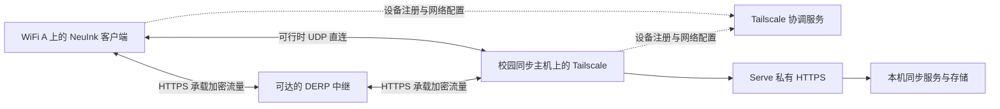

# NeuInk 校园网私有同步服务网络方案研究

核验日期：2026-11-08。用途：为未来的 NeuInk 本地优先同步服务选择临时部署网络。仅查阅 Tailscale、Headscale 官方文档与官方仓库；未安装网络软件、修改防火墙、部署服务或测试用户的校园网络。本文是方案研究，不表示 NeuInk 已实现同步、账号或远程服务。

## 1. 建议与成立条件

**小规模私有试用优先采用：校园内一台同步主机 + 各设备安装 Tailscale + Tailscale 托管协调服务 + Serve 提供私有 HTTPS。**同步数据存放在自有同步主机；网络连通交给覆盖网络。主机不需要自有公网 IP，直连失败时可使用可达的 DERP 中继。此建议成立的前提是各端能够访问所需协调、登录和中继服务，且允许安装、使用客户端。[连接类型](https://tailscale.com/docs/reference/connection-types)、[私有服务部署示例](https://tailscale.com/docs/solutions/host-private-server-docker)

**不能承诺“在服务端开放端口，就能让不同校园 WiFi 网段互通”。**这是对网络路径的工程判断：本机监听和防火墙放行只能处理本机这一段；跨 VLAN 路由、无线客户端隔离、出口过滤仍由校园网络决定。覆盖网络增加另一条可能的路径，但其外部节点也必须可达。Tailscale 官方明确列出受限网络、代理和长连接过滤可能导致连接失败。[网络映射超时排查](https://tailscale.com/docs/reference/messages/client/network-map-response-timeout)

| 已知网络条件 | 建议路径 | 能力边界 |
| --- | --- | --- |
| 校方确认客户端到同步主机可路由 | 普通私有 HTTPS，或统一使用 Tailscale 地址 | 不同网段本身不代表不通；需校方路由与访问策略支持。 |
| 网段互相隔离，但各端可访问 Tailscale 服务 | Tailscale；能直连则直连，否则 DERP | 无需同步主机公网 IP；中继速度需另行验证。 |
| Tailscale 托管服务不可达，但有各端可达的外部节点 | 评估外部节点上的 Headscale + DERP，同步主机仍留校园 | 外部节点的公网或校方路由可达性是前提。 |
| 网段隔离，且没有各端共同可达的协调/中继节点 | 请求校方提供可达服务网段、网络放行或合适接入方式 | 软件不能凭空产生传输路径；本地功能应继续可用。 |

表格是基于下文官方网络条件的部署判断，不是对该校园网的实测结论。

## 2. Tailscale 实际怎样连通

当前官方流程是：先通过 DERP 建立连接，随后尝试升级为 UDP 直连；不能直连时尝试已配置的 peer relay，否则继续使用 DERP。UDP 被阻断或 NAT 映射困难会影响直连；DERP 经 HTTPS 承载连接，通常比直连延迟更高、吞吐更低。不能把“显示在线”解释为“已经直连”或“具有局域网速度”。[连接类型](https://tailscale.com/docs/reference/connection-types)

Peer relay 是可选的自有中继，需额外部署和可达 UDP 端口，不能当作所有 UDP 都被封锁时的通用后备路径。本次最小方案不要求引入它。[Peer Relay](https://tailscale.com/docs/features/peer-relay)



图中直连和中继是可选择的传输路径；协调服务负责设备发现、公钥与策略等控制信息，不存放 NeuInk 的同步业务数据。直接通信或中继通信都由端点加解密；DERP 转发的是已加密的 WireGuard 包。[控制与数据平面](https://tailscale.com/kb/1508/control-data-planes)、[加密机制](https://tailscale.com/docs/concepts/tailscale-encryption)

由此需区分两件事：资料存储仍可自托管，但使用公共 DERP 时，加密流量可能经过校外服务器。WireGuard 的传输加密也不能替代 NeuInk 自己的存储加密、服务端授权或客户端间端到端加密设计；同步主机作为通信端点仍可能接触业务明文。这是对安全边界的工程解释。

### 网络依赖

下表概括官方推荐的网络放行条件，方向以每台 Tailscale 客户端为起点；不是要求把同步业务端口暴露到公网。

| 流量 | 用途 | 本方案中的意义 |
| --- | --- | --- |
| 出站 TCP 443 | 协调、后台服务和 DERP HTTPS | 中继工作所需的关键路径；目的服务和长连接也必须被允许。 |
| 出站 UDP，默认源端口 41641，目标端口不固定 | WireGuard 直连 | 有助直连；仅放行一个目标端口不能覆盖各种 NAT。 |
| 出站 UDP 3478 | DERP 上的 STUN 探测 | 帮助发现外部地址与 NAT 类型；与 DERP 的 HTTPS 转发是不同用途。 |
| 出站 TCP 80 | 部分协调连接、门户探测 | 可选；协调可回退到 443，门户检测可能受影响。 |

Tailscale 官方建议允许相应的出站范围，且提醒 DERP 节点会变化，不宜固化一份永久不更新的 IP 白名单。[防火墙端口说明](https://tailscale.com/docs/reference/faq/firewall-ports)

部署判断：浏览器能打开某个普通 HTTPS 网站，只能证明那条访问路径可用；不能据此证明身份提供方、协调服务器、DERP 域名及其长连接均可用。DNS 解析、首次认证与证书签发也是实际验收项。已有连接在协调服务短暂不可用时可能继续工作，不应据此承诺新设备注册、策略更新或长期离线重连正常。[网络映射排查](https://tailscale.com/docs/reference/messages/client/network-map-response-timeout)、[控制平面行为](https://tailscale.com/kb/1508/control-data-planes)

## 3. Serve、TLS 与业务服务暴露范围

建议未来同步进程只监听同机 `127.0.0.1`，由 Tailscale Serve 代理为 tailnet 内的 HTTPS 地址；访问规则只允许试用人员访问同步服务。Serve 适用于私有 tailnet，Funnel 则用于公开到互联网，试用方案无需启用 Funnel。[Serve](https://tailscale.com/docs/features/tailscale-serve)

例如，**仅当同步服务已经存在并监听 8080 时**，可以采用如下配置示意；本研究未执行此命令，8080 也不是仓库已确定的服务端口：

```powershell
tailscale serve --bg http://127.0.0.1:8080
```

`--bg` 让 Serve 后台运行；默认 HTTPS 由本机 Tailscale 进程终止，再转发到本机服务。实际地址使用命令返回的名称。[Serve 命令参考](https://tailscale.com/docs/reference/tailscale-cli/serve)

托管 Tailscale 的 HTTPS 方案需启用 MagicDNS 与 HTTPS 证书，使用 `设备名.tailnet名.ts.net`。证书通过 DNS-01 获取，因此无需为签发证书把校园主机的 HTTP 端口映射到公网；但申请与维护证书仍需相关外部服务可达。证书透明度日志会公开证书中的主机名和 tailnet 域名，命名应避免包含私人信息。[HTTPS 配置](https://tailscale.com/docs/how-to/set-up-https-certificates)

工程建议：保持正常证书验证，不用“忽略 TLS 错误”解决部署问题。若改用独立域名与反向代理，应单独设计 DNS、证书和续期；不应把 HTTPS 证书配置视为解决校园路由隔离的手段。

## 4. 网络账号与 NeuInk 应用账号

| 层次 | 管理对象 | 与 NeuInk 的关系 |
| --- | --- | --- |
| Tailscale 用户/节点身份 | 谁可把哪台设备加入 tailnet，允许访问哪些网络服务 | 托管方案依赖 Tailscale 及其身份提供方完成入网；不是 NeuInk 资料库账号。 |
| Headscale 用户/节点身份 | 自有协调服务中的节点登记与访问策略 | 可由管理员登记、预授权密钥或 OIDC 完成，替换网络控制服务。 |
| NeuInk 应用身份与授权（待设计） | 资料库所有者、设备授权、数据访问和撤销 | 应由同步协议明确表达，不因设备能访问网络端口就自动开放全部资料。 |

Tailscale 将用户认证交给身份提供方，同时建立节点身份；Headscale 提供其自己的节点注册流程。两者管理的首先是覆盖网络身份。[Tailscale 身份](https://tailscale.com/docs/concepts/tailscale-identity)、[Headscale 注册方式](https://headscale.net/stable/ref/registration/)

Serve 可以向后端传递 Tailscale 用户身份头，但 tagged device 不会带普通用户身份头。若未来采用身份头映射应用用户，应只信任受控代理路径，并让后端只监听 localhost，防止其他网络路径伪造身份头。[Serve 身份头](https://tailscale.com/docs/features/tailscale-serve)

**对 NeuInk 的设计建议：**首期可用邀请或设备配对简化应用登录，但保存独立的应用用户/设备标识、资料库权限与可撤销令牌；将 Tailscale 作为可替换的传输层。只有显式实现且验证身份映射后，才能宣传“用 Tailscale 身份登录 NeuInk”。本地阅读、编辑不应以外部网络账号登录成功为前提。

## 5. Headscale 自部署的条件与限制

Headscale 是自托管的 Tailscale 控制服务器实现，面向个人、小型组织和单个 tailnet。其角色是协调网络；NeuInk 仍需自己的同步 API、数据存储、版本与冲突协议。[项目定位](https://headscale.net/stable/)

官方一般部署要求包括公网 IP、HTTPS 443 和适合的 Linux/BSD 主机，推荐双栈。启用内置 DERP 时还需对外开放 UDP 3478；TCP 80 仅在使用内置 Let's Encrypt HTTP-01 验证等相应场景下需要。本次方案无需开放远程 gRPC 管理端口，也不公开 metrics/debug 接口。[部署要求与端口](https://headscale.net/stable/setup/requirements/)

Headscale 的内置 DERP 默认关闭；启用后默认是在 Tailscale 公共 DERP 列表之外增加一个中继。若要只用自有 DERP，须调整 DERP map。仅保留单个自有中继会产生单点故障，且内置 DERP 不以吞吐优化为目标。[Headscale DERP](https://headscale.net/stable/ref/derp/)

由此得出以下部署判断：

- 只有一台无公网 IP、无法被其他网段访问的校园电脑时，把 Headscale 和 DERP 都装在这台电脑上，并未解决外部客户端如何到达它的问题。
- 比较现实的自管拓扑是：在各客户端可达的公网节点部署 Headscale 与 DERP，校园主机和客户端主动连接该节点。同步数据仍可保存在校园主机，公网中继转发加密流量。
- 若校方提供所有试用设备可达的内部服务网段，理论上也能设计内部协调/中继网络；这是需单独验证的校园网络方案，不能直接套用公网部署说明并宣称已可用。
- 自部署增加了证书、升级、数据库备份、节点注册与中继维护工作，不作为少量设备短期试用的首选，除非托管控制服务不可用或明确要求控制层也自管。

Headscale 与 Tailscale SaaS 的功能不能无条件视为一致。当前官方仓库 `main` 的功能表已列出 Serve 支持，但开发分支与部署版本可能不同；本文不对 Headscale 的 Serve/TLS 组合做兼容承诺，也不把托管 `*.ts.net` 自动证书流程直接套过去。选择 Headscale 时应按固定版本核验业务 HTTPS 方案。[官方功能表源码](https://raw.githubusercontent.com/juanfont/headscale/main/docs/about/features.md)

## 6. 无公网 IP 时的回退顺序

1. **仅校园同步主机没有公网 IP：**先用托管 Tailscale，保留 DERP 回退。没有公网 IP 本身不是放弃条件；所需外部服务是否可达才是关键。
2. **能加入 tailnet，但直连失败：**允许继续中继，分别验证少量元数据和大 PDF 的传输体验。若附件中继过慢，优先减小初次传输量、采用按需附件策略，并研究可达的自有中继；不能把中继连通等同于性能达标。
3. **托管控制服务或公共中继受阻：**只有在存在各端共同可达的节点时，才转向自托管 Headscale/DERP；公网节点可以是外部基础设施，不要求校园同步主机本身获得公网 IP。
4. **既没有公网节点，也没有校方允许的内部公共服务路径：**请求网络管理员提供路由、服务网段或合适接入方式。继续支持本地工作，网络恢复后再补同步。若另行设计离线交换，应使用具有校验与冲突处理的导入/导出协议，不能把多人直接复制运行中的资料目录当作同步实现。

以上是结合官方连接与部署条件作出的工程建议；没有验证当地网络可达性，也没有承诺任何云节点、运营商或公共中继在该环境可用。

## 7. 实施前的最小验收证据

下面是后续部署的验收建议，本研究未执行：

- 选两台真实设备，分别连接目标校园 WiFi/网段，完成首次认证与入网。
- 用 `tailscale netcheck` 查看 UDP、NAT 与中继情况；传输期间结合 `tailscale status` / `tailscale ping` 区分 `direct`、`relay` 和 `peer-relay`。Headscale 自建中继可另查 `tailscale debug derp headscale`。这些结果应与应用层 HTTPS 请求一起判断。[连接状态](https://tailscale.com/docs/reference/connection-types)、[Headscale 排查工具](https://headscale.net/stable/ref/debug/)
- 验证 HTTPS 主机名与证书、网络访问策略、应用令牌和资料库权限；能建立隧道不代表允许访问所有资料。
- 用样例资料测量首次同步、小修改、大附件、中断重试、主机重启与 WiFi 切换。验收后再决定是否让真实资料参与试用。
- 记录同步主机离线、登录服务不可达和 DERP 不可达时的行为；本地内容应保留，失败不能推进“已同步”状态。

研究结论的实际验证边界：未完成校园跨网段连接、DERP 性能、Headscale 部署、证书签发或 NeuInk 原生 Tauri 同步体验验收。
