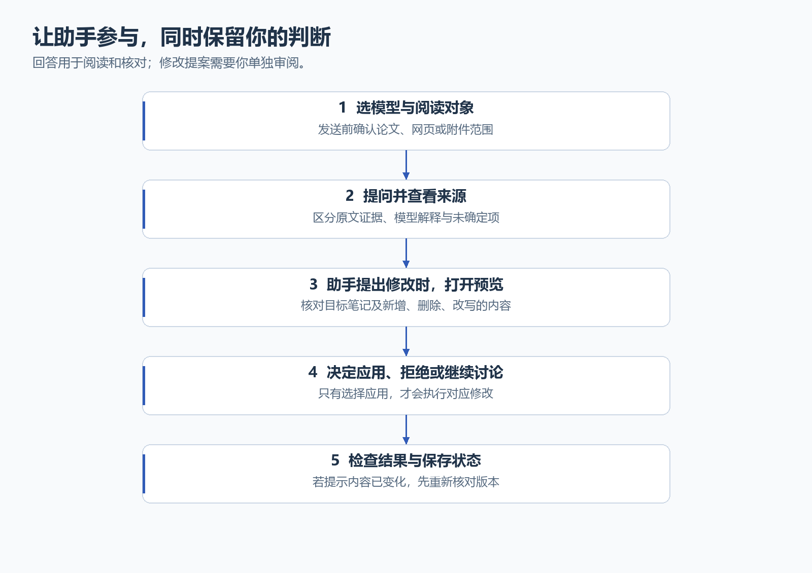
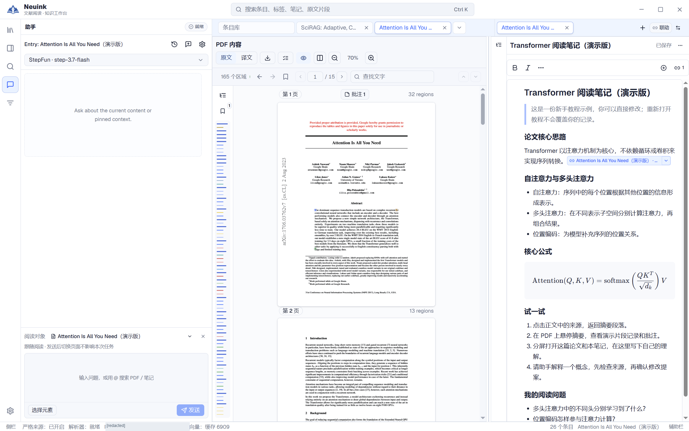
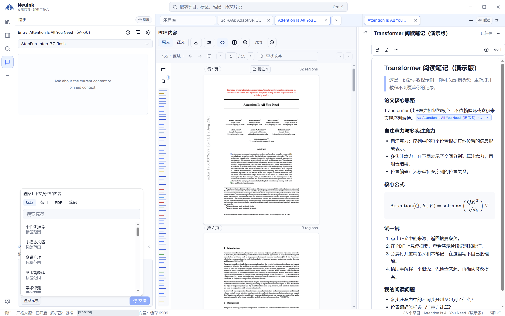
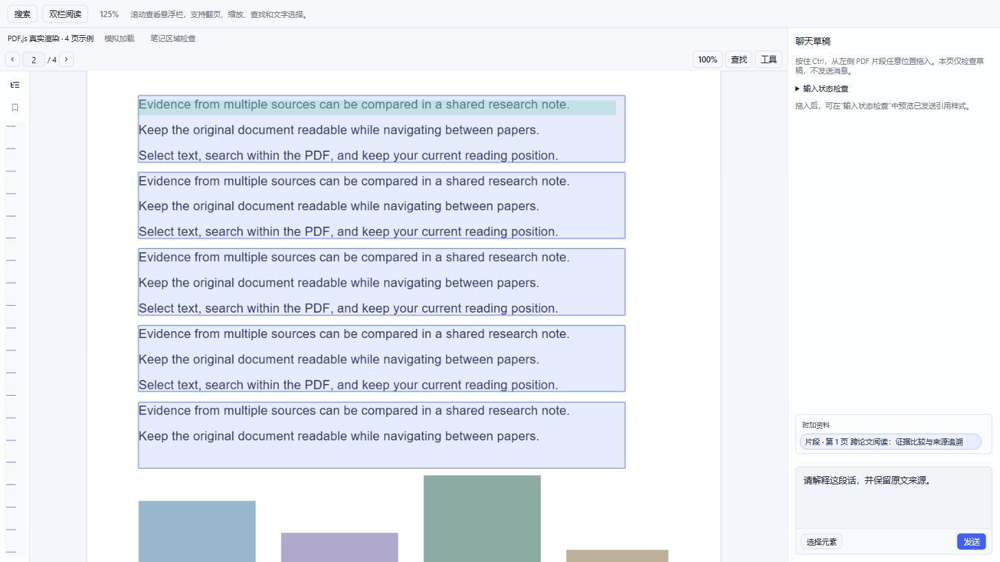
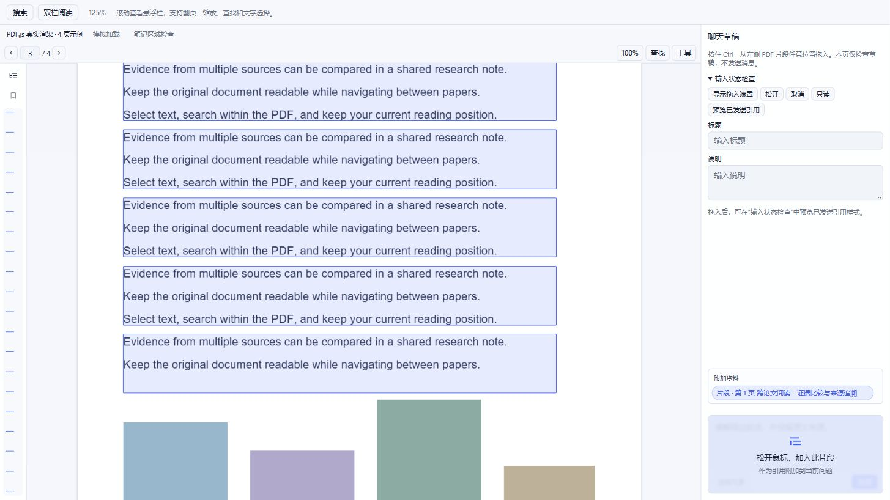

助手可以解释材料、检索证据、整理文档笔记和提出元数据修改。可靠使用的关键是：先选对上下文，再核对来源，最后确认修改结果。

## 从提问到确认修改

普通提问可以止于查看回答。只有助手提出修改时，才需要后面的预览和应用步骤；拒绝提案不会修改笔记。

## 按步骤看实际界面

按下面的步骤找到入口，并检查操作结果；点击图片可放大查看。

### 1. 确认模型和阅读对象

打开助手，检查顶部模型和底部阅读对象。图中关联演示论文，尚未发送问题；右边保留原文和笔记用于核对。

### 2. 选择额外上下文

点击“选择元素”，按标签、条目、PDF 或笔记选择材料。核对范围后再输入问题并发送；发送前再次确认已选材料就是这次问题所需的范围。

## 0.1.1：拖入引用，预览并回到原文

在 PDF 中按住 **Ctrl**，从目标片段内拖到聊天输入框；遮罩出现后松开即可加入引用。普通拖动仍用于选中文字。也可以右键片段，选择添加到助手；列表内容默认针对当前列表项，整段列表需要显式选择。

草稿和已发送消息里的引用都支持悬停查看原文详情、点击定位到对应页或片段。草稿引用右侧在悬停或键盘聚焦时显示删除按钮，删除后可以撤销；已发送的引用保留在消息记录里。

这张历史图展示当时的阅读器与输入组件，不是 0.1.3 原生窗口实拍；示例不调用模型服务。

遮罩显示“松开鼠标，加入此片段”，便于确认释放目标；图中的检查按钮属于演示工具，不是应用正式入口。

## 使用 Claude Code 等本地 Agent

在“工具与扩展 → 本地 Agent”启用检测，选择本机已经安装并完成认证的 Claude Code，然后在助手顶部切换执行方式。也提供 Codex 和 OpenCode 接入；是否可用取决于本机安装、认证和服务状态，检测到程序不代表连接一定成功。

新对话沿用最近一次显式选择的模型或 Agent；打开历史对话仍使用该会话的原引擎。已选 Agent 不可用时会提示处理，不会静默换成其他模型发送。

本地 Agent 的操作确认可选择仅允许本次或记住授权；已记住的授权可在同一设置页撤销。Neuink 中的笔记和元数据修改仍需经过提案审阅。本地客户端可能连接远程模型，其名称不代表推理完全离线。

## 配置对话模型

在“模型与助手”新建连接，选择接口协议、地址和模型 ID，按服务要求填入密钥。测试连接后指定“助手对话模型”。阅读翻译使用独立任务模型，详见[模型设置](settings.md)。

Neuink 不捆绑大语言模型。连接本地模型或远程模型由你选择，发送的上下文会交给该服务处理。

## 阅读对象与 @ 附件

助手可关联当前论文、PDF、文档笔记或受支持的阅读对象。用 `@` 选择 PDF 或文档笔记；通过“选择元素”附加条目、标签等材料，通过 Ctrl 拖动或右键添加片段；不需要任何材料时选择“不关联内容”。

分屏中应确认当前聚焦对象。显式选择的材料、当前对象和历史引用会影响范围；不要只凭侧栏中显示的论文标题推断本轮已经读了哪些内容。标签综合笔记当前不作为普通附件或通用修改目标。

## 可以怎样提问

- **解释**：“根据当前片段解释这个方法，区分原文结论和你的补充说明。”
- **比较**：“只比较这两篇论文中的评价指标和实验条件，不同口径请分开列出。”
- **整理**：“将已核对的研究问题、方法、结果和局限整理为文档笔记提案，保留来源。”
- **发现**：“检索与当前主题相关的公开论文，给出真实链接，暂时不要导入。”

这些是提问示例，不是内置按钮或保证输出的固定模板。证据不足时应保留未确定项。

## 未解析 PDF 也能问吗

有可用文字层时，助手可以按页做基础读取与字面搜索。每次页读取至多 5 页，文字搜索每次至多扫描 20 页；基础上下文在需要时读取前 3 页以内，并说明覆盖与截断。

这条路径不执行 OCR、不自动提交解析，也不把条目标为已解析。扫描页、双栏顺序、复杂图表与公式可能不可靠；需要结构化证据时应使用 MinerU 结果。

## 来源、工具与完整回复

回答中的来源应能对应实际取得的证据。工具记录用于了解发生过哪些读取或检索，不能把工具失败当作“没有相关文献”。外部 URL 证据与本地页码来源会分别保留。

长回复可打开完整回复标签，与论文并排阅读。表格、公式和 Mermaid 在支持的回复中渲染；图表内容仍需核对。对话历史与执行记录保存在资料库中，可回看提案和工具状态。

## 从提案到实际保存

1. 助手提出新建或修改文档笔记、片段笔记、标签或元数据的建议。
2. 打开修改预览，查看新增、删除以及修改前后的完整内容块。
3. 核对来源、目标和改动范围，选择应用或拒绝。
4. 如果提示目标内容已经变化，先重新查看当前版本，再决定是否应用。

收到一份提案不等于文件已经修改。已应用修改也不因后来停止对话而自动回滚。

## 排队、停止与失败

运行中的消息与待发消息在任务区分别显示，待确认、待选择和暂停也有独立状态。停止会取消当前执行，但不会撤销此前已完成的入库或已确认修改。

如果读取或检索失败，可以调整问题后重试；如果模型不可用、额度不足或保存失败，请先处理提示的问题。需要排查时，在“工具与扩展 → 诊断”开启助手调试信息，记录错误提示和发生步骤；不要将密钥或完整私密正文贴入公开问题。

## 0.1.2：查看本地 Agent 返回的思考

选择已安装并登录的 Claude Code、Codex 或 OpenCode 发起对话。工具返回思考文本或摘要时，执行详情旁出现“思考过程”，生成期间显示最近内容的两行预览。点击或用键盘展开查看已返回全文；完成后仍可从历史消息展开查看。

思考与正式答复分开保存，停止任务后不再追加。不同工具、模型与配置提供的内容可能不同；没有返回思考时只显示实际执行状态，不保证取得模型全部内部推理。

