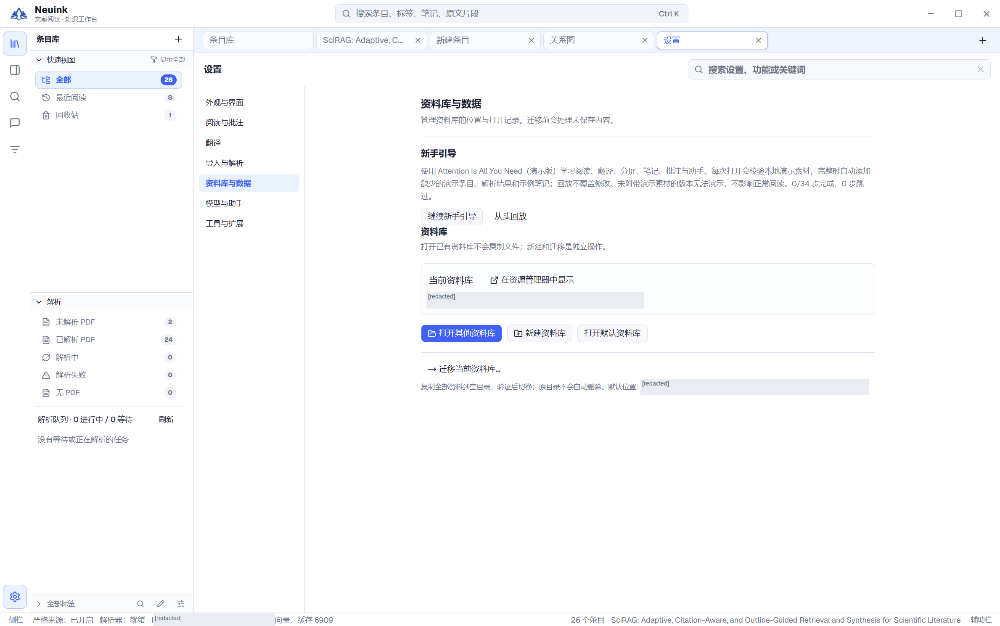

本地优先意味着用户文件是资料库的权威数据。你可以在本地阅读、编辑、检索和导出；需要解析、模型或在线研究时，再连接相应服务。

## 按步骤看实际界面

按下面的步骤找到入口，并检查操作结果；点击图片可放大查看。

### 1. 找到打开、新建与迁移入口

进入“资料库与数据”，查看当前库、新建／打开／迁移操作及新手引导。打开或新建资料库时选择保存目录；需要更换目录时再使用迁移。

## 资料库保存什么

Workspace 包含条目元数据、PDF、解析片段、图片、批注、片段笔记、文档笔记、标签综合笔记、译文及会话等文件。`.neuink-cache` 存放可重建派生缓存。

文档笔记正文与来源数据需要配套保留；标签笔记还包含其来源和归属信息。不要仅凭扩展名为 Markdown 就随意删除相邻文件。设置与密钥不等于 Workspace 内容，备份一个库不代表已备份全部应用配置。

## 打开、新建与最近使用

从“资料库与数据”打开现有库，或新建到合适目录。打开已有库不会复制内容；无有效资料库标识的普通目录不会被静默转换。

最近使用列表只是打开记录。从列表移除一条记录不等于删除磁盘上的资料库。

## 迁移到另一位置

使用“迁移当前资料库”，选择符合要求的空目录。应用先处理未保存内容，再复制、验证并切换；原目录不会自动删除。

迁移后核对论文、笔记、来源与图片，再自行决定旧目录如何保留。不要在两个进程中同时编辑同一资料库；当前保护不等于多用户或多进程协作协议。

## 换一台电脑继续阅读

安装包和资料库分别保存。另一台电脑先下载并解压相同版本的 Neuink，再打开资料库副本；复制 EXE 或重新下载安装包不会带上已有论文和笔记。

### 一次性搬到另一台电脑

1. 在原电脑进入“设置 → 资料库与数据”，点击当前资料库的“在资源管理器中显示”。记录这个目录，不要把程序解压目录当成资料库。
2. 保存笔记，等待解析、下载与助手写入完成，然后退出 Neuink。复制整个资料库目录，包括隐藏文件和全部子目录；也可以完整打包后通过移动硬盘或自己的私有网盘传递。
3. 在新电脑完整复制或解压。资料库根目录应包含 `neuink.workspace.json`，并保留 `entries/`、`conversations/` 等原有目录。只复制 PDF、Markdown 或 `entries/` 会漏掉其他资料与关联。
4. 启动 Neuink，在“设置 → 资料库与数据 → 打开其他资料库”选择包含 `neuink.workspace.json` 的目录。两台电脑上的绝对路径可以不同。
5. 核对几篇论文、带图片的笔记、来源跳转及聊天记录。模型接口和本地 Agent 按新电脑的环境重新配置；确认副本完整前保留原库。

| 内容 | 复制完整资料库后 |
| --- | --- |
| PDF、已保存解析、图片、批注、片段笔记、文档笔记、标签笔记、译文 | 随资料库保留。外部网址或手工引用库外文件仍依赖其原位置。 |
| 已保存的聊天内容与引用 | 随资料库保留；本地 Agent 的底层会话能否续接另见下文。 |
| 论文当前页、已读页与阅读时长 | 保存在条目的 `paper.reading.json` 中，可随资料库保留。 |
| 标签页、分屏、精确滚动位置、缩放、界面与阅读偏好 | 保存在本机，不会随资料库复制。新电脑打开论文可按已保存页码恢复，不能保证恢复原窗口布局或精确位置。 |
| API Key、接口地址、最近选择的模型或 Agent、授权记录 | 属于本机设置，需在新电脑配置。 |
| 未保存草稿、正在执行的任务 | 不作为可迁移成果；搬迁前完成保存并等待任务结束。 |

Claude Code 等本地 Agent 还需在新电脑单独安装和登录。Neuink 会话里保存了消息，但 CLI 自己管理底层会话；复制资料库不能保证原 Agent 对话继续执行。遇到会话无法恢复时新建对话，再引用已有论文或笔记。

### 两台电脑轮流使用

当前没有内置的跨设备同步服务或多端冲突合并。可以用自己信任的文件同步工具搬运资料库，但需要按“电脑 A 保存并退出 → 等待上传完成 → 电脑 B 等待下载完成 → 打开资料库”的顺序使用；换回 A 时同理。

例如使用 OneDrive 时，两台电脑登录自己的同一账号，将一个专用资料库目录同步到本地。已有资料库可以先备份，再通过“迁移当前资料库…”复制到同步目录中的空文件夹；以后使用迁移后的库。把整个目录标记为“始终保留在此设备上”，确认文件下载完成后再打开。具体操作见微软的[文件同步说明](https://support.microsoft.com/en-us/onedrive/sync-your-computer-s-files-and-folders-with-onedrive)和[本地保留文件说明](https://support.microsoft.com/en-gb/onedrive/save-disk-space-with-onedrive-files-on-demand-for-windows)。这是外部文件同步的使用方式，尚未完成 Neuink 双机同步实测。

两端不要同时编辑同一个库，也不要在 Neuink 打开期间用另一台电脑的旧副本覆盖它。出现冲突副本时先保留两份，确认内容后再处理；同步服务不能代替独立备份。

七牛 CDN 与 GitHub Release 在本项目中用于公开分发安装包。个人资料库、聊天记录和密钥不应传到公开下载空间。只向别人分享笔记或阅读成果时，使用[导出](export.md)，无需交付整个资料库。

## 回收站与恢复

条目、笔记及归档标签具有对应恢复入口。恢复后，原有来源关联可以继续检查和使用。标签关联变化、同名冲突或父标签缺失时可能要求先处理问题。

永久删除与软删除不同。来源快照仍可读不代表原 PDF 仍可恢复；缓存也不是用户数据备份。

## 备份建议

完成保存并退出写入后，复制整个资料库到自己的备份位置，保留目录结构。恢复时先在副本中打开并核对文件。应用没有在本手册中承诺自动云备份或团队同步。

使用第三方同步盘是用户自己的存储选择，不能把文件同步等同于支持多人同时编辑。出现外部文件冲突时不要强行覆盖唯一副本。

## 哪些操作需要网络

| 操作 | 数据去向 |
| --- | --- |
| 本地 PDF／已解析阅读、笔记、关键词搜索、已保存成果导出 | 在本机处理。 |
| 本地语义检索 | 使用本地 embedding 资源；运行时不静默下载。 |
| 远程解析 | PDF 发送到你配置的解析服务。 |
| AI 对话与翻译 | 相关上下文发送给你指定的模型服务。 |
| 在线论文／网页研究 | 查询与请求发送给所用外部服务。 |
| 当前网页读取 | 按需读取后将必要内容交给模型；公开媒体提取可能重新请求资源。 |

“本地优先”不意味着所有 AI 操作都离线。可以选择本地模型与本地解析服务，但仍需自行配置并检查它们的行为。

## 保存保护的边界

应用对常规保存、关闭、切换与提案写入进行版本和未保存内容检查。突然断电或崩溃后完整草稿恢复、所有外部冲突自动解决、团队并发编辑都不是当前保证。
