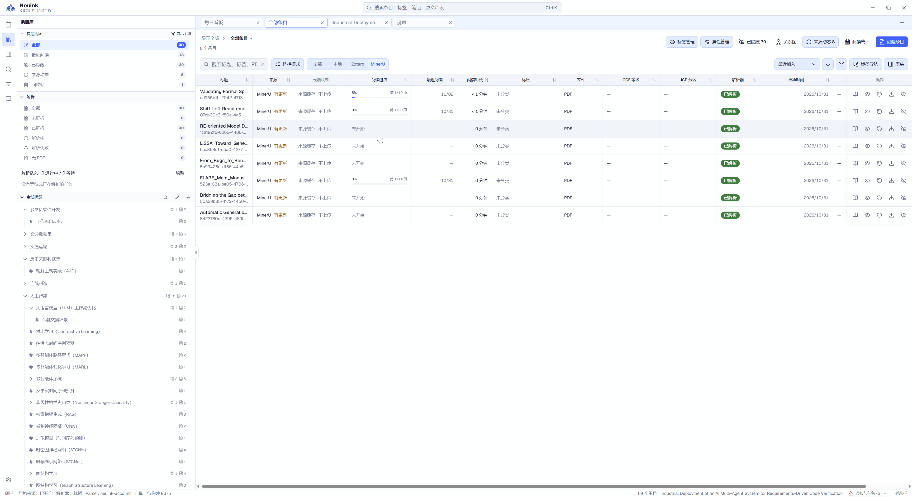
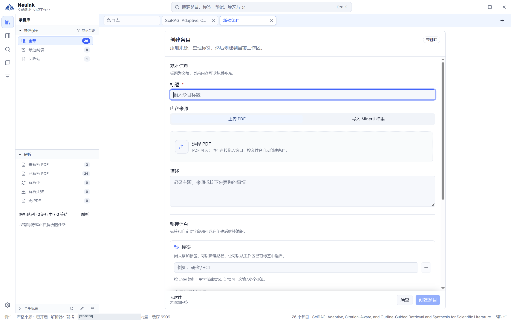
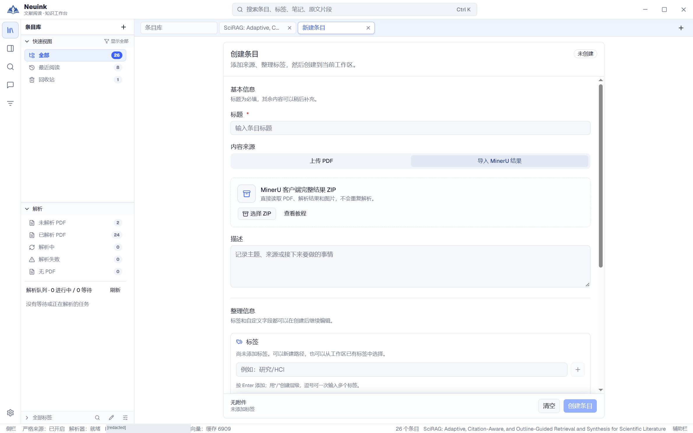
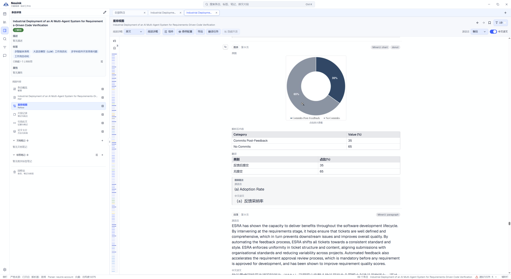
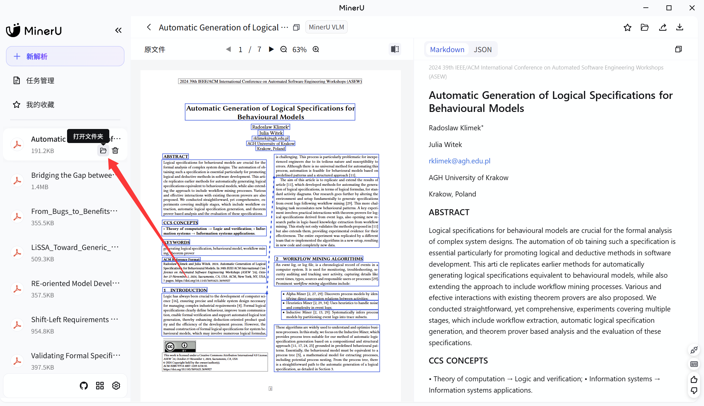
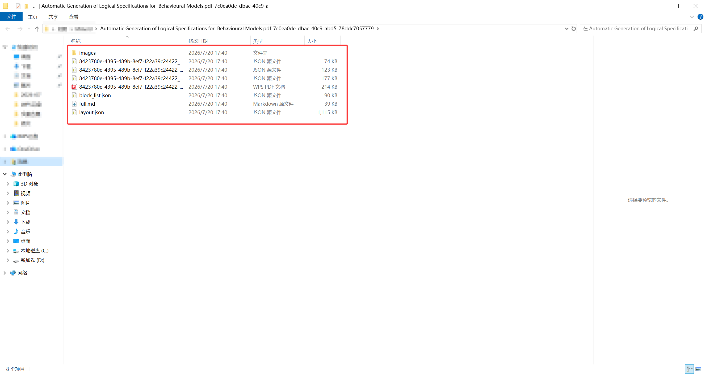

导入负责把文件放进资料库，解析负责识别段落、标题、表格、公式和图片。**能够打开 PDF，不等于已经有结构化解析结果。**

## 推荐路线：MinerU 客户端 → Neuink

1. 在 MinerU 客户端导入 PDF 并完成解析，保留完整结果目录。
2. 在 Neuink“设置 → 导入与解析”的本地来源区域，添加 MinerU 结果目录。
3. 从顶部新标签入口打开 MinerU 解析结果，或在条目库选择 MinerU 来源，浏览可用内容。
4. 选择需要的论文，明确“导入到本地”。来源缓存不等于独立本地条目，不会因为浏览就自动作为本地论文上传。
5. 打开 PDF 或重排阅读，再按需要[配置小牛翻译](translation.md)、写笔记或接入大模型。

已有结果不需要再次请求在线解析。也可以将完整结果压缩成 ZIP 或 RAR，按下方步骤导入；目录和压缩包都需保留结构文件及图片相对路径。

## 直接导入 PDF 或结果包

没有现成结果时可以先创建条目并选择 PDF；之后再解析。已有结果包则从对应导入入口选择，并按要求配对原 PDF。以下表单保留较早版本示例，当前入口以应用为准。

完成后从同一条目进入 PDF 或重排，阅读正文、公式、图表及其译文。

## 路径一：先导入 PDF

在条目库创建条目并附加 PDF，或批量拖入 PDF。导入后可以立即使用原文阅读器；解析可之后再做。需要重新附加或创建新版 PDF 时，从条目概览的文件操作进入。

默认不会在导入后自动提交解析服务。需要自动解析时，先选好可用的账号解析或自建 MinerU 服务，再主动开启“导入 PDF 后自动解析”。此偏好同时出现在“导入与解析”和“阅读与批注”中。

## 选择服务：账号解析或自建 MinerU

“选择解析方式”提供两个同级选项，一次只使用一种。配置当前选中的服务后，再提交需要解析的 PDF。

### 账号解析服务

1. 自行部署 Neuink 后端及其解析服务，或取得所用部署的地址和账号，参见[后端部署说明](https://github.com/SugrSertraline/neuink/blob/beta/deploy/server/README.md)。
2. 在“账户与存储”填写该 Neuink 后端地址，连接验证成功后登录。
3. 回到“导入与解析”，选择账号解析服务，确认账户可用。
4. 从条目发起解析，或按需要开启自动解析；在右下角任务区查看排队和进度。

账号解析使用你连接的 Neuink 后端，由后端统一排队后交给所部署的 MinerU 处理，不需要每位用户填写 MinerU 地址。它不代表客户端附送公共免费解析额度。服务繁忙时会等待队列，重复提交不会让同一任务更快。账号由管理员提供，暂不开放自助注册。

### 自建 MinerU 服务

选择“自建 MinerU 服务”，填写兼容服务 URL，可按服务要求填写 API Key；请使用服务提供方给出的接口地址和密钥。

不要把第三方网页地址或 LLM Base URL 当成解析接口。使用远程服务时，PDF 会发送到该地址；切换来源后核对当前选择，再提交任务。

## 路径二：读取 MinerU 目录或导入结果包

已有 MinerU 客户端结果时，可以直接导入。应用内提供结果导入说明；先在客户端完成解析，保留完整目录或压缩为 ZIP／RAR，再返回 Neuink。它与在线解析服务是两条独立路线。

### 第一步：完成解析，打开结果文件夹

在 MinerU 客户端完成 PDF 解析后，找到对应任务，点击任务旁边的文件夹按钮。下图红箭头指向“打开文件夹”；右边能看到解析后的文字。

**检查结果**：应打开这篇论文的解析结果目录，而不是仅下载一份 Markdown。图中是 MinerU 客户端，不是 Neuink；客户端版本变化时按钮位置可能不同。

### 第二步：保留完整结果目录，按需压缩

保留结构化 JSON、图片目录及原有相对路径。下图红框展示一份结果目录：有 images 文件夹、多个 JSON、PDF 与 Markdown。截图中的本地路径已做遮挡。

**检查结果**：需要有 Neuink 支持的 content_list_v2.json 或兼容 content_list.json；部分长文件名在图中被截断，请实际检查完整文件名。不能仅凭图里的 block_list.json 或 full.md 判断结果可导入。读取目录时直接保留完整文件夹；需要用包导入时，再将完整结果压缩成 ZIP 或 RAR，保留图片相对目录。

### 第三步：回到 Neuink，选择导入目标

- **用 ZIP 创建新条目**：同时附上原 PDF。
- **向已有 PDF 条目导入结果**：无需在 ZIP 中重复附 PDF。

ZIP 导入不要求填写解析服务 URL 或 API Key。只打包一份 Markdown 文本不等同于完整 MinerU 结果；缺少结构文件或图片时，需回到结果目录检查。对应的 PDF 与 ZIP 表单见本页前面的实机步骤图。

### 第四步：打开 PDF 和重排，核对结果

确认 PDF 的片段框、重排正文、表格与图片对应同一篇论文。正文能显示但图片缺失，仍不能视为完整导入；具体检查清单见下方“如何检查解析质量”。

## 队列、失败与重试

在右下角任务区区分等待队列、上传、解析、结果下载、完成和失败。失败时查看具体提示，核对登录状态、服务是否可达、PDF 是否有效，再重试。仅等待队列不会自动修复错误配置。

ZIP 导入直接使用已生成结果，不需要再次请求服务。已有解析结果被替换后，片段标识或内容可能变化，旧来源和译文会接受有效性检查。

## 如何检查解析质量

| 检查对象 | 应该核对什么 |
| --- | --- |
| 双栏正文 | 段落顺序是否与原页一致，有无串栏或重复。 |
| 表格 | 表头、列对应、数值和脚注是否完整。 |
| 公式 | 符号、上下标与编号是否正确。 |
| 图片与流程图 | 是否缺图，图注是否关联到正确对象。 |
| 附录与参考文献 | 是否被保留，页码和正文顺序是否合理。 |

解析结果是辅助阅读数据，原 PDF 仍是核对依据。完成解析不代表扫描文字、复杂图表或全文覆盖已经人工验证。

## 相关功能

解析结果用于[重排](reflow.md)、片段搜索、[来源链接](sources.md)和[全文翻译](translation.md)。未解析 PDF 的助手降级文字读取有独立限制，详见[助手](assistant.md)。

## 沿用 Zotero 与 MinerU 来源

已有 Zotero 资料无需先全部手工搬迁。可以连接本机来源目录、按需导入独立副本，再选择导入并核对笔记。参见 [Zotero 资料与笔记](zotero.md)。

支持 MinerU ZIP、RAR 或目录与可选原始 PDF 配对；已有条目可校验后替换阅读 PDF，保留解析内容。导入处理前的原始 PDF 有助于保留文内跳转；具体内容仍需与原文核对。
