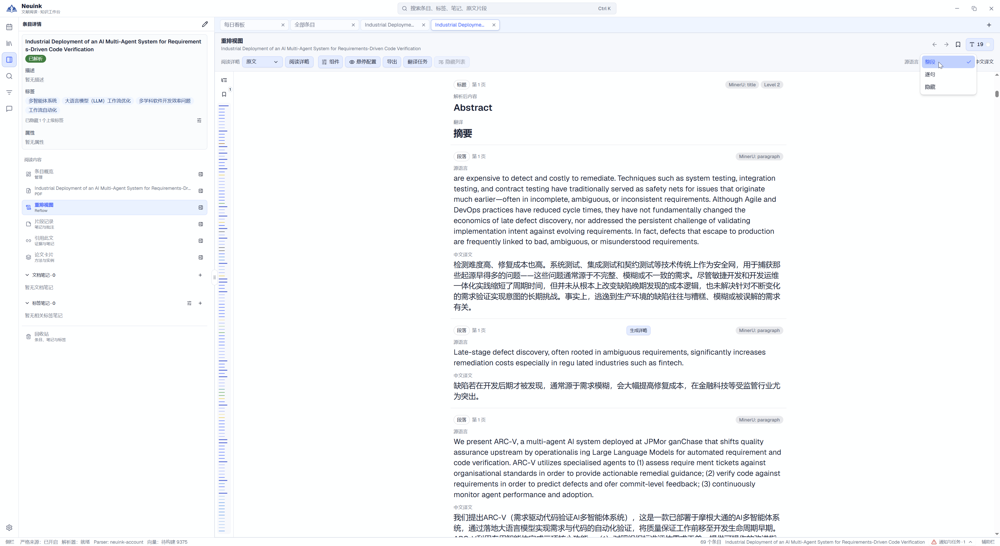
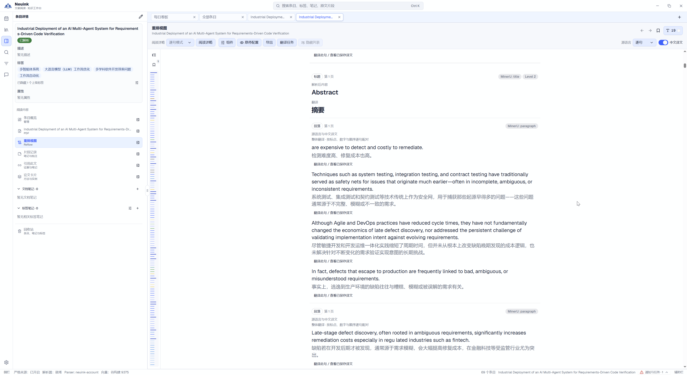
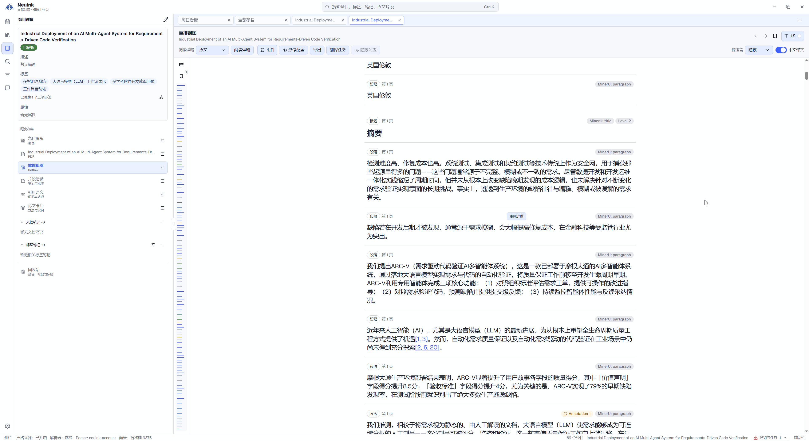
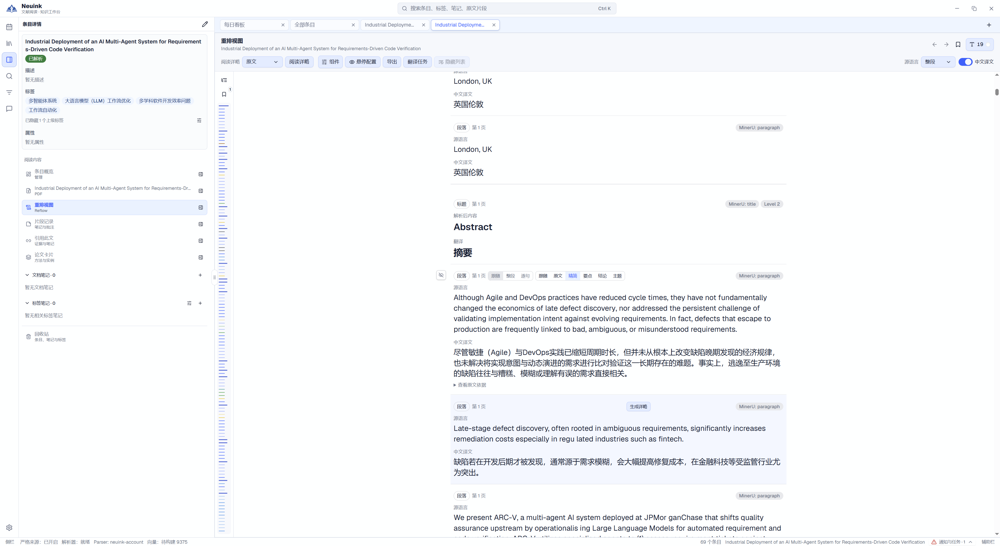
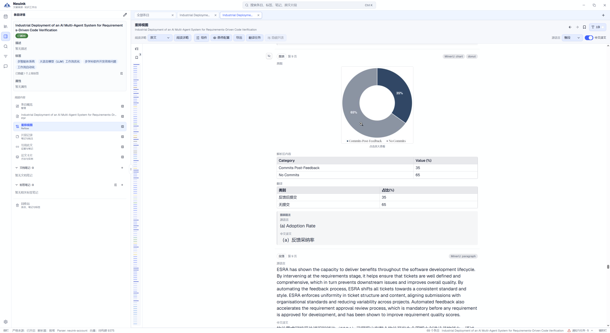
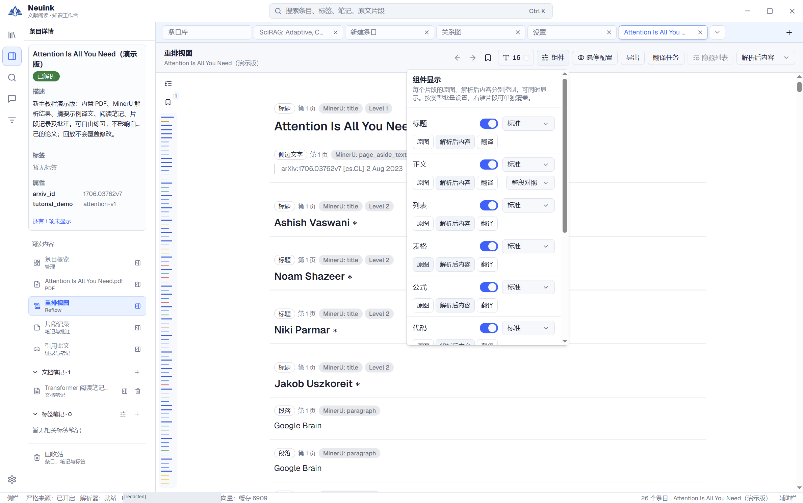

重排视图把解析结果变成适合屏幕阅读的连续内容，尤其适合双栏论文和窄分屏。它是从解析数据生成的阅读视图，不能替代原页的科学证据。

## 整段、逐句或纯中文阅读

从条目打开重排阅读，在源语言菜单选择整段、逐句或隐藏，再独立决定是否显示中文译文。已有译文可在不同显示方式间复用。

## 用 TextFold 调整阅读详略

阅读详略在原文、精简、要点、结论、主题之间切换，语言显示与详略分别选择。生成后可整篇切换，也可对单段调整，保留返回原文依据的入口。

## 阅读图表与结构内容

原图、解析后的表格或图示、译文可在阅读流程中一起查看。

组件菜单可以控制标题、正文、列表、表格和公式等类型的显示。以下是较早版本的组件菜单示例，隐藏只改变当前显示。

## 支持的内容

重排呈现标题、正文、列表、表格、公式、代码、辅助文字、图片与图表。可用内容取决于 MinerU 实际输出；解析器没有识别出来的信息不会被阅读器自动补全。

公式使用可用的数学表示渲染，表格沿用解析结构。科学流程图若提供 Mermaid，可按对应展示模式阅读；图形渲染成功不等于图中逻辑已被验证。预览无法渲染时仅提示“渲染失败”；可回到原图或 PDF 核对内容。

## 阅读详略与逐句对照

阅读详略提供原文、精简、要点、结论、主题五级。“原文”表示完整内容，与显示源语言还是中文无关；语言和详略可以分别选择。

1. 打开“生成详略”，选择要处理的正文段落，再开始生成；仅打开窗口不会调用模型。一次生成会处理原文及对应的中英结果，语言切换可以沿用已保存内容。
2. 在任务窗口按页码、文字或状态筛选，可查看原文和已有结果；支持暂停、继续、取消和重试，已保存的结果保留。
3. 结果生成后，用顶部控件切换整篇详略，或在段落操作中单独调整。按住 Ctrl 滚动滚轮也可调整符合条件段落的详略。

短段落、公式、图表和不适合压缩的内容保留原样。尚无详略时，悬停工具中的相关选项显示为不可用，并提供“生成详略”入口；未生成或生成失败时保留原文。

失败原因显示在右下角任务提示中，可以进入任务查看失败段落并重试。原文校验、模型返回格式和翻译失败是不同原因；已成功保存的结果保留。生成内容仍需与原文核对。

源语言可选整段、逐句或隐藏，并独立控制中文译文。逐句模式暂停详略展示；切回整段后可继续选择详略。全局切换直接更新内容，单段调整保留过渡效果。已有缓存会保留，切换显示本身不重新调用模型。

本页完整窗口截图展示当前语言与详略入口；组件菜单单独保留较早版本示例。

## 内容显示与字号

在阅读视图的设置中调整正文字号、背景及各类内容的显示偏好。可以隐藏流程图或某类辅助内容，也可以调整图片／图表尺寸。

显示偏好只改变阅读界面，不删除源数据。完整全文导出不会因为你折叠段落、隐藏图片或滚动到某一处而只输出可见部分。

## 原图与解析内容

每个适用片段可独立选择显示原图、解析内容或相应组合。表格结构不可靠时，用原图核对列与数值；公式或流程图有疑问时，回到 PDF 页确认。

打开图片详情后，可放大与拖动查看；宽表格在局部区域滚动，不需要把全局界面缩得很小。图片在界面中保留，并不表示图片内部的英文已被翻译。

## 原文、译文和双语

翻译显示可选择原文、译文或双语对照；逐句对照等操作需要对应片段有可用译文，必要时触发翻译请求。没有译文、正在翻译和失败会有不同状态。

全文翻译与局部阅读翻译共用配置的阅读翻译模型。详见[翻译任务](translation.md)，尤其是暂停、继续以及旧译文的处理。

## 片段记录与来源

在段落旁查看或编辑对应的片段笔记、批注，使用来源操作连接到当前可编辑笔记。重排和 PDF 指向同一文献与解析片段，不需要分别维护两套笔记。

## 如何保持证据可靠

遇到正文顺序异常、表格丢列、缺图或公式缺项时，保留问题并核对原 PDF。导出检查会报告它能够检测到的缺项，但无法保证原 PDF 中所有信息都被解析出来；“所有已解析片段均已处理”不是“原文毫无遗漏”。
