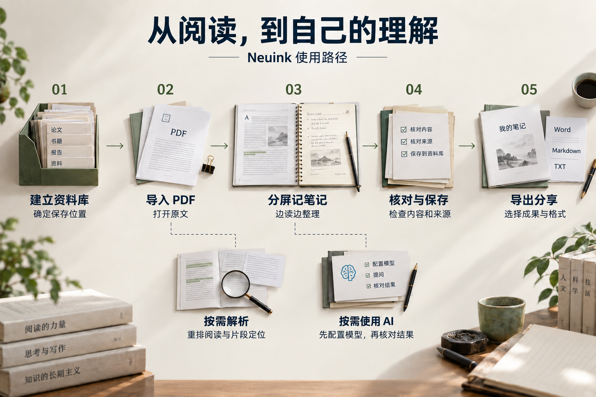
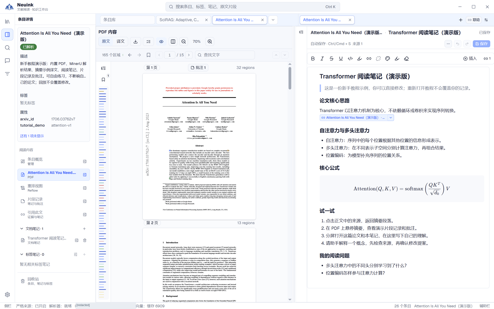

Neuink 把文献、阅读位置、笔记和证据放进一个本地资料库。第一次使用，可以先完成一条很短的路线：**打开一篇 PDF → 记下一条想法 → 给想法附上来源 → 保存笔记**。解析、翻译和 AI 都可以之后再配置。

## 先走完一条阅读流程

先完成左侧主流程。需要重排或精确片段时再导入解析结果；需要翻译或助手时再配置模型。不熟悉“条目”“片段”等名称，可以先看[核心概念](concepts.md)。

## 对照完整工作台

左侧找到论文，中间核对 PDF，右侧整理笔记并检查保存状态。点击图片可查看原尺寸；服务地址已遮挡。每个操作的独立步骤图见[截图导航](screenshots.md)，可继续进入导入、翻译、来源追溯和导出教程。

## 准备与安装

**[下载 Windows x64 便携版（ZIP，CDN 直链）](https://cdn.sugrsertraline.top/Neuink-windows-x64-portable.zip)**

下载后将整个压缩包解压到一个文件夹，再双击 `Neuink.exe`，不要在压缩包内直接运行。更新前关闭应用并备份整个 `data`；将新版程序与原 `data` 放在一起，不要用新包的空目录覆盖已有数据。

从 [GitHub Releases](https://github.com/SugrSertraline/neuink/releases) 查看维护者已发布的版本、平台与说明。没有适合的平台产物时，可按仓库的[构建说明](https://github.com/SugrSertraline/neuink/blob/main/docs/deployment/packaging-and-distribution.md)从源码运行；下载前查看对应版本的支持平台与使用说明。

Windows 便携包需要完整解压，再运行 `Neuink.exe`。保留随包的资源目录；运行成品不需要 Node.js 或 Rust，系统需有 WebView2 Runtime。请以该版本的发布说明为准，不将调试目录中的程序当成便携版。

## 数据默认保存在程序旁

Windows 0.1.2 首次启动会在程序文件夹内建立 `data`，资料库位于 `data/library`，无需新建或选择路径。请把程序完整解压到可写目录，例如自己的文件夹或 U 盘，避免放在需要管理员写入权限的位置。

论文、笔记、聊天、设置和阅读状态随整个 `data` 保留。保存并退出后复制完整程序文件夹，即可携带到另一台 Windows 电脑；本地 Agent 仍需在那里单独安装和登录。旧版 `neuink_data` 的自动整理与冲突处理见[数据管理](data.md)。

## 先导入，再决定要不要解析

1. 在条目库创建条目并导入 PDF，或把 PDF 拖入支持导入的区域。
2. 打开论文，确认原始页面能够显示。
3. 想用重排、精确片段和结构化阅读时，再[导入 MinerU 结果](import.md)。
4. 在条目概览补充标题、说明、标签与需要的属性。

PDF 原文阅读不依赖解析。解析失败时，也不需要为了继续阅读而反复删除、重建条目。

## 写下第一条带来源的笔记

从条目详情新建文档笔记，输入标题并打开编辑器。可以把笔记放在一侧、PDF 放在另一侧。已解析文献中的片段可通过来源相关操作插入当前可编辑笔记；插入后检查来源预览与原文位置，再保存。

正文、片段笔记和批注有不同用途。暂时只想记住某段的位置，可以使用“记住此处”，不必新建整篇笔记。完整区别见[笔记、批注与收藏](notes.md)。

## 按需要开启 AI

在“模型与助手”配置连接，先测试，再分别指定助手模型与阅读翻译模型。回到助手，检查当前关联的阅读对象；通过 `@` 增加所需材料，然后提问。

例如：“根据当前论文说明研究问题、方法与局限，并给出来源；没有读到的部分请明确说明。”这是一条可参考的提问，不保证任何模型都能一次完成。助手提出笔记修改时，仍需你审阅并确认。

## 新手引导与演示数据

首次打开空资料库时可进入新手引导；之后从“资料库与数据 → 新手引导”继续或回放。可跳过暂未配置的解析或模型练习。

离线演示取决于安装包是否包含演示资源。缺少资源时显示“缺少演示数据，无法演示”，不会自动下载论文。演示摘要中的预置译文不是实时模型结果，也不代表整篇已经翻译。教程进度与实际业务操作分别记录。

## 完成后的下一步

- 想读得更舒服：查看 [PDF](pdf.md)、[重排](reflow.md)与[翻译](translation.md)。
- 想整理同一主题：查看[标签](library.md)与[平行阅读](parallel.md)。
- 想交给同学或导师：查看[导出分享](export.md)，选择实际需要的成果范围。

## 使用 0.1.1 的新交互

阅读 PDF 时按住 Ctrl 拖动一个片段到助手输入框，再输入具体问题。引用可以悬停预览、点击回到原文；未发送的引用可删除。没有 PDF 的条目可在详情尝试“获取 PDF”。

如果使用已安装并登录的 Claude Code，在“工具与扩展”启用本地 Agent，再到助手顶部选择。重新打开同一资料库可继续上次阅读，新对话也会沿用上次选择的执行方式。详见[助手教程](assistant.md)与[工作台恢复](workspace.md)。
