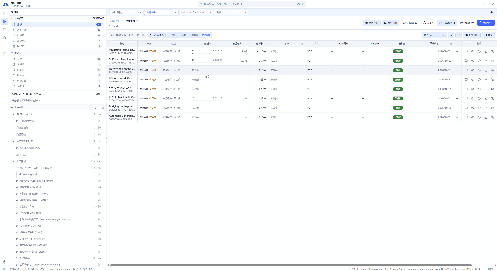
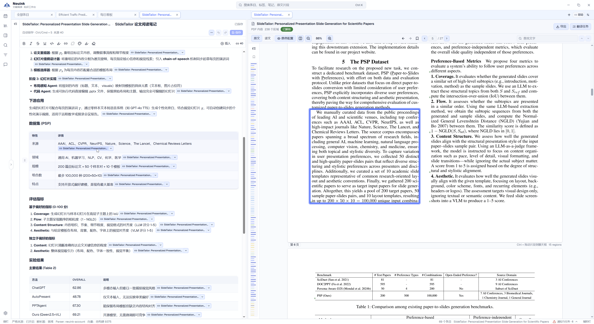
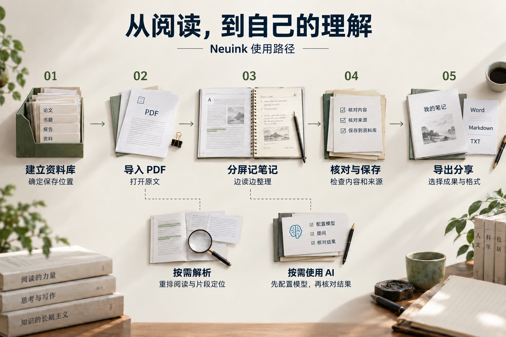

Neuink 将多种翻译、MinerU 解析、Zotero 接入、阅读笔记和大模型助手放进同一个工作台。推荐先用 **MinerU 客户端解析 + Neuink 阅读与笔记 + 小牛翻译**；大模型和云端服务都按需要选择。

## 推荐上手路线

1. **用 MinerU 客户端完成解析**：下载并安装 MinerU 客户端，将 PDF 导入并完成解析，保留完整结果目录。
2. **让 Neuink 读取结果目录**：在“设置 → 导入与解析”添加 MinerU 本地结果目录，打开来源列表，选择需要的论文并明确“导入到本地”。
3. **配置小牛翻译**：在“设置 → 翻译”展开小牛翻译，填写自己的 API Key，验证并保存，再选择对应翻译任务使用的来源。
4. **开始阅读与记录**：在 PDF 或重排视图阅读，使用划词、段落或全文翻译，按整段、逐句或纯中文显示，并分屏整理笔记。
5. **按需选择大模型**：需要论文问答、辅助整理或 TextFold 阅读详略时，再配置自己的模型；也可接入本机已安装并登录的 Codex 等 Agent。

**MinerU 解析 → 读取结果目录并导入本地 → 小牛翻译 → 阅读与笔记。** 来源缓存与独立本地副本分开管理；查看来源不会自动导入整个目录。详见 [MinerU 导入](import.md)、[翻译设置](translation.md)和[助手接入](assistant.md)。

## 下载与安装

当前支持 **Windows 10 / Windows 11 x64**。手册介绍当前产品能力，下载包的具体版本与内容以对应发行说明为准。

**[下载 Windows x64 便携版（ZIP，CDN 直链）](https://cdn.sugrsertraline.top/Neuink-windows-x64-portable.zip)** · [GitHub Releases](https://github.com/SugrSertraline/neuink/releases)

将整个压缩包解压到可写文件夹，再运行 Neuink.exe；不要在压缩包内运行。保留随包资源，成品无需安装 Node.js 或 Rust，系统需有 WebView2 Runtime。macOS 版本已停止提供和维护。

更新前退出 Neuink 并备份整个 data，替换程序时保留自己的数据目录。

## 用原文和译文一起读

先对一个术语或段落翻译，再根据需要启动全文任务。原始 PDF 保留版式，原文与译文也可左右对照；重排视图支持整段双语、逐句对照和纯中文阅读。单词查询可优先使用本地词库，翻译不要求先配置大模型。

## 接入已有资料

除了推荐路线，也可直接导入 PDF，之后选择服务解析；已有 MinerU 结果支持目录、ZIP 或 RAR。PDF 原文阅读无需等待解析结束。

连接本机 Zotero 目录后可浏览来源条目与笔记，只有主动导入才生成 Neuink 独立副本。标签整理研究主题，属性记录年份、期刊、会议或其他自定义字段。参见 [Zotero](zotero.md)与[条目管理](library.md)。

## 写下第一条带来源的笔记

从条目详情新建文档笔记，将 PDF 和笔记分屏打开。通过片段菜单插入来源引用或图片，在笔记中记录理解；来源链接便于预览证据并返回原文。简单想法也可以写成批注或片段笔记。

从阅读到成果的步骤可以参考下图；解析、翻译与 AI 按所选路线加入，操作详见[笔记指南](notes.md)。

## 按需要接入大模型或本地 Codex

“模型与助手”支持自定义大模型连接，服务商和模型由你选择。助手、翻译和阅读详略可按任务分配。配置完成后，在助手确认阅读对象，用选择元素、@ 或 Ctrl 拖入片段补充材料，再提问。

本机已经安装并登录 Codex、Claude Code 或 OpenCode 时，可启用本地 Agent 检测与连接，在助手顶部选择执行方式。模型服务或本地 Agent 都不是基础阅读的必选项。

## 本地优先，数据随程序保存

基础阅读、整理和笔记无需登录。Windows 便携版默认使用程序旁的 data，首次启动建立 data/library。把程序放在可写目录，保存并退出后复制整个程序文件夹，可携带到另一台 Windows 电脑；本地 Agent 仍需在该电脑单独安装和登录。

解析、翻译和 AI 按需调用所选服务。云端同步默认关闭，提供[配套后端源码与部署说明](https://github.com/SugrSertraline/neuink/blob/beta/deploy/server/README.md)，可自行部署并连接，也可完全不用。账号解析使用已部署的 Neuink 后端，不是下载客户端后自动获得的公共解析服务。详见[可选同步](sync.md)和[数据备份](data.md)。

## 继续探索

- 阅读与理解：[PDF](pdf.md)、[重排与 TextFold](reflow.md)、[翻译](translation.md)。
- 整理与记录：[标签和属性](library.md)、[平行阅读](parallel.md)、[来源链接](sources.md)。
- 查看与分享：[当前界面图集](screenshots.md)、[导出](export.md)、[工作台](workspace.md)。

## 新手引导与演示数据

当前新手引导入口暂时隐藏，已有进度保留；可按本页流程上手。离线演示取决于安装包是否包含对应资源，缺少时不会自动下载论文。教程图用于说明功能，下载包不包含截图中的个人资料。
