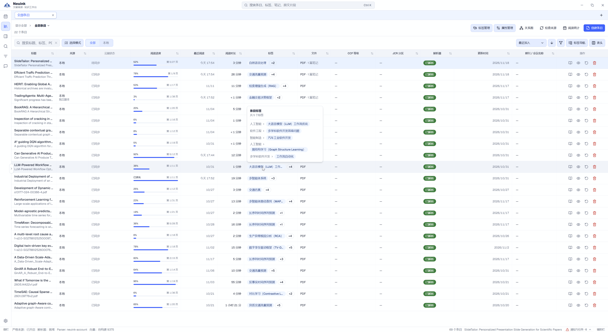

云端同步将支持的本地资料与阅读成果带到其他设备，并在条目库和右下角任务区展示状态。Neuink 提供[配套后端源码与部署说明](https://github.com/SugrSertraline/neuink/blob/beta/deploy/server/README.md)，可以自行部署后连接使用，也可以完全不开启云端功能。

基础阅读、资料整理和笔记无需登录。服务器可达范围、账号、空间与解析能力由所连接的部署提供；客户端下载不等于已开通公共云服务。

## 默认关闭，确认后开启

全新安装默认不配置服务器地址，也不绑定云端资料库。仅填写 URL 不会启动同步：必须连接验证成功，再登录，最后核对范围并点击“确认并开启同步”。连接失败不能跳过验证；修改地址后需要重新连接。

已明确开启同步的老用户，更新程序并保留原 data 时会保留原有选择，不会因升级强制关闭。需要停用时可在账户中关闭自动同步。不要把日常使用的 data 连同发行包提供给其他用户。

## 先连接，再登录

1. 自行部署 Neuink 后端，或取得所用部署的地址与账号。
2. 打开“设置 → 账户与存储”，填写该部署的服务器 IP 或完整地址，点击连接。
3. 连接验证成功后，使用该部署的账号登录。当前客户端暂不开放自助注册，需要账号请联系该部署的管理员。
4. 在“当前资料库同步”点击“开启同步”，核对同步范围、新增附件及云端已有内容，确认后才开启。

当前使用默认云端资料库，界面不提供改名。绑定后，云端已有的可同步内容也会下载到本机；开启同步不只是单向上传。请先备份本地 `data`。

## 服务器连接与账号解析

连接方式由服务器部署决定，请完整使用管理员提供的协议、地址和端口。已配置的服务器会保留，后续在“更改”弹窗里修改；重试连接成功后即可继续登录。若部署使用 HTTPS 且提示证书错误，请联系管理员提供正确的信任配置，不要关闭证书校验。

账号解析与云端同步使用同一个 Neuink 账户，但开启账号解析不等于开启同步；同步仍需单独确认。账号解析由所连接后端的 MinerU 服务与队列提供；具体服务能力和账号由该部署管理。

## 哪些内容参与同步

| 内容 | 当前行为 |
| --- | --- |
| 明确导入的本地论文 | 同步已支持的条目信息、PDF 和相关附件。 |
| 阅读与整理成果 | 支持阅读快照、笔记、批注、标签、译文和阅读详略。 |
| 已确认的研究构思 | 保留已保存内容及来源信息，不把未确认草稿当作完成成果。 |
| Zotero 等来源缓存 | 始终归类为来源，不作为普通本地论文上传；明确导入后产生的独立副本才参与。 |
| 应用配置与运行环境 | 不等于整个 `data` 备份；不要依赖它迁移密钥、Agent 登录、所有聊天或原始解析工程。 |

实际可用范围以开启前的检查和任务结果为准。缺少依赖、附件或空间时保留待处理状态，不把部分完成显示为全部成功。

## 在条目库看上传状态

在列设置中显示“云端状态”：

| 状态 | 含义 |
| --- | --- |
| 来源缓存 · 不上传 | 来自外部来源，尚未明确导入本地副本。 |
| 未开启同步 | 当前资料库没有开启云端同步。 |
| 待同步 | 当前内容尚未全部得到服务器确认。 |
| 已同步 | 检查到的当前内容已得到服务器确认，不代表以后新增的编辑也已上传。 |
| 存在冲突 | 同一内容的版本需要比较和处理。 |
| 需要处理 | 状态检查或相关内容存在问题，前往账户页查看原因。 |

状态采用增量检查，未变化的条目复用短期结果；实际上传仍校验内容。外部编辑的变化可能稍后才显示，状态列不是实时备份保证。

## 查看云端内容和任务

账户页的“查看云端内容”读取服务器记录，可搜索和浏览对象信息、附件与删除记录。它是内容清单，不是在线 PDF 阅读器或完整的云端笔记编辑器。

同步进度与结果显示在右下角任务区。发生问题时可通过“立即处理”进入账户设置；同步问题平铺显示，按具体原因处理。需要手动推进时使用“立即同步”或“重试同步”，自动同步开关可暂停后续同步并停止本次任务，已完成内容保留。

## 常见问题怎么处理

| 情况 | 处理方式 |
| --- | --- |
| 显示失败，但冲突列表为空 | 失败不一定是版本冲突。查看同步问题中的连接、依赖、附件或空间提示。 |
| 来源条目、解析或标签依赖尚未就绪 | 核对相关本地内容是否存在、是否已经完成保存或导入，然后重试；不要删除待同步内容来消除提示。 |
| 出现版本冲突 | 比较保留的本地与云端内容，确认后选择处理；支持的笔记冲突可手工合并。 |
| 云端空间不足 | 先检查占用与旧版本；清理需要预览并确认，不会因为查看空间就删除内容。 |
| 下载暂时没有进度 | 查看任务阶段及错误，确认服务器地址与网络连接；不要把“附件已确认”误当成正在传输新字节。 |

“同步维护”用于恢复服务器备份或长期离线后的重新核对，日常同步通常不需要。删除可能传播到其他设备，云端同步不能替代独立备份。更多说明见[数据与恢复](data.md)、[当前版本范围](updates.md)。
