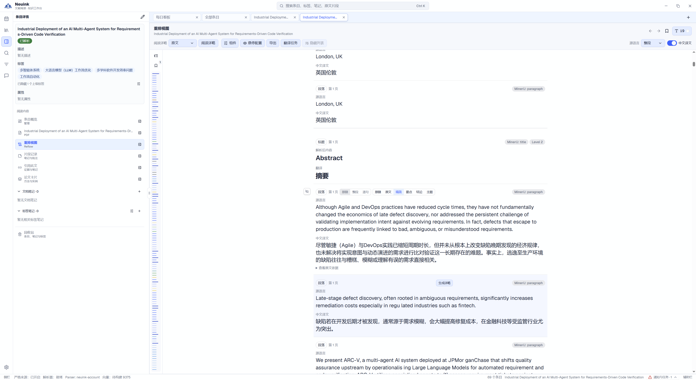
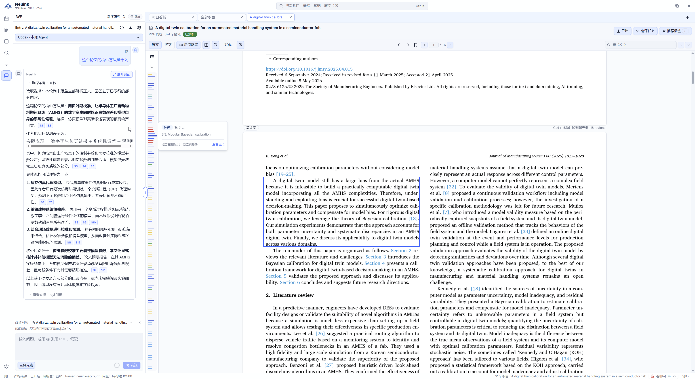

最近整理：**2026-11-18**。这里介绍当前产品能力与推荐使用方式。手册已接入最新完整窗口截图；具体下载包的版本与内容以发行说明为准。

## 从翻译开始阅读

推荐先配置小牛翻译，也可选择 DeepL、Azure、Qwen-MT 或自己配置的大模型。单词、选区、片段、逐句和整篇可统一来源，也可分别选择。

原始 PDF 保留版式，支持原文与译文分屏；重排可在整段双语、逐句对照和纯中文之间切换。全文翻译任务支持暂停、继续与失败重试，已有译文保留。

查看[翻译与双语阅读](translation.md)。

## 推荐 MinerU 客户端与已有 Zotero 资料

推荐路线是 **MinerU 客户端解析 PDF → Neuink 读取结果目录并明确导入本地 → 配置小牛翻译 → 阅读与笔记**。已有 MinerU 目录、ZIP 或 RAR 可直接沿用，不必重复请求解析。

Zotero 接入本机资料，来源缓存保持来源身份；只有明确导入才生成独立本地副本。来源笔记可导入、比较差异，并在支持的条件下明确确认写回。

“导入与解析”仍提供账号解析和自建 MinerU 两种服务方式。账号解析连接自行部署的 Neuink 后端，经服务器队列处理；它与直接导入已有结果分别使用。“导入 PDF 后自动解析”默认关闭，在阅读与解析设置中调整同一个偏好。

查看 [MinerU](import.md)与 [Zotero](zotero.md)。

## 用属性和文件夹整理资料

- **统一属性定义**：独立属性管理页决定整个资料库使用的字段，条目详情与表格编辑每篇论文的值。
- **多种字段类型**：文本、数字、日期、单选、多选和是否。日期可精确到年、月或日，选项可逐项增删和排序。
- **发表信息与评价字段**：期刊/会议、年份、DOI、作者、JCR、CCF 等可直接填写，评价等级由用户自行核对。
- **表格快速编辑**：点击属性值修改，选项变更直接保存，也可留空。
- **查找空白属性**：arXiv、Crossref 结果经选择后填充支持的空白字段；Sciverse、Zotero 已知字段映射到中文，冲突内容保留。

纯表格、纯标签文件夹、标签与表格三种视图可以切换。表头对话框提供排序、列设置，列宽可拖动；操作按钮随宽度逐项收进“更多”。查看[条目、标签与属性](library.md)。

## 多种阅读与笔记，配合 TextFold

PDF 原文、重排、图表悬停、多标签与左右分屏可以配合使用。批注、片段笔记、文档笔记与标签综合笔记各自保留用途，来源链接连接记录与原文。

TextFold 阅读详略提供原文、精简、要点、结论和主题，支持整篇切换和单段调整。生成时处理对应的中英结果；已保存结果可以继续使用，失败段落可单独重试，原因在任务区查看。

查看[重排与 TextFold](reflow.md)、[笔记](notes.md)和[来源链接](sources.md)。

## 大模型自选，也能接入本地 Codex

模型与服务商由你选择，支持兼容接口及不同任务分工。本机已有并登录的 Codex、Claude Code 和 OpenCode 可通过本地 Agent 接入，在 Neuink 内结合论文、笔记与引用使用。

助手回答保留来源入口；需要改笔记或资料时先查看提案，再决定是否应用。查看[助手使用](assistant.md)与[模型设置](settings.md)。

## 本地优先，云端按需部署

基础阅读、整理与笔记无需登录，数据默认保存在便携程序旁的 data。解析、翻译和 AI 按需配置，材料交给所选服务处理。

云端同步默认关闭，提供[配套后端源码与部署说明](https://github.com/SugrSertraline/neuink/blob/beta/deploy/server/README.md)。可以自行部署、验证连接并登录后确认开启，也可完全不用。同步范围、云端内容和问题处理见[同步指南](sync.md)。

账户和本机存储放在同一设置页；服务器连接成功后保留配置，可在“更改”弹窗编辑。来源读取、下载、解析和同步任务集中在右下角，按任务查看状态与处理入口。

## Windows 便携版

当前支持 **Windows 10 / Windows 11 x64**，不再提供或维护 macOS 版本。完整解压后运行 Neuink.exe；更新前退出并备份 data，保留自己的资料目录。

- [推荐上手路线](start.md)
- [当前完整窗口功能图集](screenshots.md)
- [Windows 便携版下载](https://cdn.sugrsertraline.top/Neuink-windows-x64-portable.zip)
- [GitHub 发行版本与说明](https://github.com/SugrSertraline/neuink/releases)
- [数据保留与备份](data.md)
